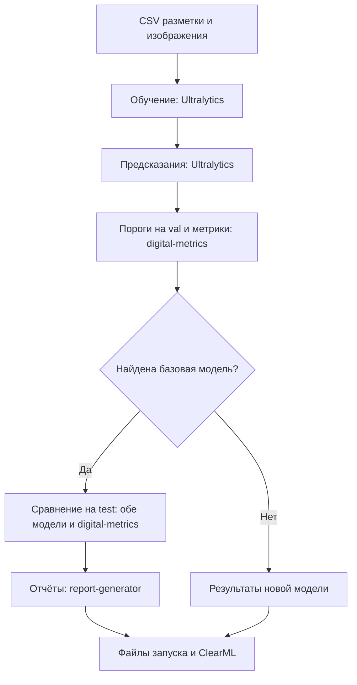

# clearml-yolo

`cy` обучает модели детекции, получает предсказания и считает метрики. Если есть модель
для сравнения, команда сравнит результаты и подготовит отчёты. Для запуска нужны
изображения и CSV с разметкой — передайте его через `ground_truth`.

По умолчанию обучение и предсказания выполняет **Ultralytics YOLO**. Через группу
`model` также выбираются **DEIMv2**, **RF-DETR** и **Faster R-CNN** с современными
backbone. Метрики считает **digital-metrics**,
отчёты создаёт **report-generator**. `cy` вызывает эти библиотеки по порядку
и сохраняет настройки и результаты в ClearML.

## Установка

Нужен Python 3.12. Подготовьте утверждённые локальные копии `digital-metrics` и
`report-generator` по [инструкции установки](docs/development.md#external-dependencies),
затем установите зависимости из корня проекта:

```bash
uv sync --frozen
```

Для DEIMv2, RF-DETR и Faster R-CNN добавьте `--extra detectors`, для ONNX — также
`--extra export`. Минимальные версии — Torch 2.13.0 и Torchvision 0.28.0;
зафиксированная пара в `uv.lock` — 2.14.1 и 0.29.1. DEIMv2 требует отдельный checkout
исходников на зафиксированной ревизии; TensorRT устанавливается отдельно. Подробности —
[модели и настройка](docs/multi-model-backends.md) и
[развёртывание TensorRT](docs/tensorrt-deployment.md).

## Быстрый старт с YOLO

### 1. Создайте конфигурацию

```bash
cy-init-config cy-config
```

Команда создаст `cy.yaml` и две группы настроек: `ultralytics/default.yaml` и
`ultralytics_predict/default.yaml`. По умолчанию экспортируется только `cy`.
Для другой команды выберите её явно, например:

```bash
cy-init-config predict-config --command cy-predict
```

Допустимы `cy`, `cy-train`, `cy-predict`, `cy-val`, `cy-metrics`, `cy-report`,
`cy-compare`, `cy-ground-truth` и `cy-export`. Пять команд с YOLO создают обе нативные
группы; команды работы с таблицами — только свой YAML. `cy-export` по умолчанию
выбирает Faster R-CNN. Используйте имя команды как `--config-name`.
Существующий выбранный файл вызывает ошибку; `--force` заменяет обычные файлы.
Файлы других команд не изменяются.

### 2. Укажите разметку и имя эксперимента

В `cy-config/cy.yaml` заполните `ground_truth` и секцию `clearml`:

```yaml
ground_truth: ./ground_truth.csv
clearml:
  project_name: detection
  task_name: yolo11n-first-run
  tags: [quickstart]
```

Замените путь к CSV, проект, имя задачи и теги на свои. Редактируйте эти поля
в созданном файле, сохраняя остальные настройки и список `defaults`.
Относительный путь `ground_truth` считается от каталога запуска команды.

В CSV должны быть непустые выборки `train`, `val` и `test` в столбце `split`.
`cy` использует это разбиение без изменений и сам готовит данные для обучения.
Пути к изображениям внутри CSV считаются от каталога CSV.
Описание столбцов и координат — в [формате входных данных](specs/004-ground-truth-training/contracts/cli.md).

### 3. Перенесите параметры Ultralytics

Параметры обучения запишите в `cy-config/ultralytics/default.yaml`. Например:

```yaml
model: yolo11n.pt
epochs: 100
imgsz: 640
batch: 16
device: -1
```

Параметры предсказаний — в `cy-config/ultralytics_predict/default.yaml`:

```yaml
batch: 8
conf: 0.001
iou: 0.7
device: -1
```

Измените эти поля в созданных файлах, сохраняя остальные настройки.
Пишите ключи без обёрток `ultralytics:` и `ultralytics_predict:`.
Поля `data`, `source`, `project` и `name` из Ultralytics переносить не нужно:
ими управляет `cy`. В обоих файлах оставьте `device: -1`, чтобы команда
выполнила обучение на явно выбранном устройстве. Для распределённого обучения см. [DDP и очередь выполнения](#ddp-и-очередь-выполнения).

### 4. Запустите `cy`

```bash
cy --config-dir cy-config --config-name cy
```

Для разового изменения параметра добавьте его к команде:

```bash
cy --config-dir cy-config --config-name cy ultralytics.epochs=50
```

Подробнее о YAML — в [описании конфигурации](specs/005-explicit-detection-config/contracts/native-configuration.md).



`cy` подбирает пороги на `val` и использует их при дальнейшей оценке.
Обе модели сравниваются на одних изображениях `test` с одинаковыми настройками предсказаний.

Для сравнения `cy` берёт модель из последней завершённой задачи с тегом `prod`
в том же проекте ClearML. Текущая задача в этот поиск не входит.
Если подходящей задачи нет, вы получите результаты новой модели без сравнения и отчётов.

В новом эксперименте `cy` заново запускает старую модель на выборке `test`
из текущего `ground_truth` и считает её метрики по этой разметке. Обе модели
оцениваются на актуальных данных, а не по результатам прежнего эксперимента.
Веса и ранее подобранные пороги старой модели сохраняются. Если повторить сравнение
в том же каталоге без изменения входов и настроек, готовые предсказания могут
использоваться повторно; метрики пересчитываются.

Чтобы выбрать модель сами, добавьте `compare.baseline_model.task_id=ID_ЗАДАЧИ`.
Если указанную модель не удастся загрузить, команда завершится с ошибкой.

### 5. Откройте результаты

В ClearML откройте проект `detection` и задачу `yolo11n-first-run`.
Все результаты `cy` собраны в одной задаче.

| Результат | Где искать |
|---|---|
| Настройки и ход выполнения | `Configuration`, `Console`, `Scalars` и `Plots` задачи ClearML |
| Лучшие веса `best.pt` | `Output Models` задачи обучения |
| Разметка и предсказания | Артефакты `gt_csv` и `predicts_csv` |
| Пороги и метрики | Артефакты порогов, панели метрик и графики |
| Сравнение и отчёты | Книги XLSX, если найдена базовая модель и сравнение выполнено |
| Локальные файлы | `runs/<проект>/<задача>-<task-id>/` с именами, пригодными для файловой системы |

Если хотите выбрать каталог сами, добавьте `run_dir=./runs/experiment-01`.
Для каждого запуска используйте новый каталог. Если загрузка обязательных файлов
в ClearML не удалась, команда сообщит об ошибке. Локальные файлы сохранятся.

## DEIMv2, RF-DETR и Faster R-CNN

Выберите модель при создании конфигурации:

```bash
uv sync --frozen --extra detectors
cy-init-config detector-config --command cy --model rfdetr/small
```

Будут созданы `detector-config/cy.yaml` и `detector-config/model/rfdetr/small.yaml`.
В первом укажите `ground_truth` и настройки ClearML, во втором — секции `train`
и `predict`. Для этих моделей параметры имеют префиксы `model.train.` и
`model.predict.`. Например:

```bash
cy --config-dir detector-config --config-name cy \
  ground_truth=./ground_truth.csv model.train.epochs=20 \
  model.train.device=-1 model.predict.device=-1 \
  clearml.project_name=detection clearml.task_name=rfdetr-small \
  'clearml.tags=[rfdetr,experiment]'
```

| Семейство | Значения `model=` |
|---|---|
| DEIMv2 | `deimv2/s`, `deimv2/m`, `deimv2/l`, `deimv2/x` |
| RF-DETR | `rfdetr/nano`, `rfdetr/small`, `rfdetr/medium`, `rfdetr/large` |
| Faster R-CNN + ResNet FPN | `fasterrcnn/resnet50_fpn`, `fasterrcnn/resnet101_fpn` |
| Faster R-CNN + ConvNeXt/Swin | `fasterrcnn/convnext_tiny`, `fasterrcnn/swin_tiny` |
| Faster R-CNN + DINO | `fasterrcnn/dinov2_small`, `fasterrcnn/dinov3_small` |

CSV и общие этапы оценки сохраняются; данные COCO для новых моделей готовятся
автоматически. По умолчанию запрашивается pretrained-инициализация. DEIMv2 требует
`model.source_dir` с утверждённой ревизией и явный `model.train.weights` либо
`model.train.backbone_weights`. Для CPU задайте обоим этапам `device=cpu`.
Новые адаптеры поддерживают CPU и один CUDA GPU; DDP для них пока не реализован.
Неизвестные настройки, несовместимые веса и отсутствующие pretrained-ресурсы
вызывают ошибку без подмены модели или скрытого случайного старта.

Лучший нативный чекпойнт передаётся предсказаниям, калибровке и сравнению.
Его метаданные содержат архитектуру, классы и preprocessing; базовая модель
сравнения выбирается независимо. Для внешних весов без этих сведений нужны
явные поля `ModelRef`. Настройки, ограничения разрешения и примеры приведены в
[руководстве по моделям](docs/multi-model-backends.md).

Для Faster R-CNN добавлена команда `cy-export`: ONNX на CPU, сборка и проверка
TensorRT на GPU. Отдельный runner не требует Torch и не создаёт задачу ClearML.
См. [руководство развёртывания](docs/tensorrt-deployment.md).
Результаты нативной приёмки пресетов, скачивания моделей из ClearML и проверки
матрицы TensorRT, включая оставшиеся ограничения, находятся в
[журнале проверки](specs/025-multi-model-backends/verification.md).

## Переход с Ultralytics и ручных скриптов

Если сейчас вы вызываете библиотеки из CLI или Python-скрипта, таблица поможет
найти знакомые шаги в `cy`. Оценку через `digital-metrics` и отчёты нужно учитывать
отдельно от встроенной в Ultralytics проверки `val`.

| Шаг | Вручную через CLI или Python | Через `cy` |
|---|---|---|
| Данные | Подготовить YOLO-разметку для Ultralytics и таблицу разметки для оценки | Передать готовый CSV через `ground_truth`; данные для Ultralytics подготовит `cy` |
| Обучение | Вызвать Ultralytics `train`; найти лучшие веса | Обучить модель и передать полученные веса следующим стадиям |
| Предсказания | Вызвать Ultralytics `predict`; выгрузить рамки, классы и уверенность в CSV | Получить предсказания по выборкам и сохранить таблицы |
| Пороги | Передать результаты `val` в `digital-metrics`; сохранить пороги | Подобрать пороги на `val` и зафиксировать их для оценки |
| Метрики | Запустить `digital-metrics` с разметкой, предсказаниями и порогами | Рассчитать метрики и сохранить панели и графики |
| Сравнение | Загрузить две модели; запустить их на одной `test`; оценить обе через `digital-metrics` | Заново получить предсказания старой модели на текущей `test` и сравнить её с новой |
| Отчёты | Передать результаты сравнения двух моделей в `report-generator` | Создать технический и бизнес-отчёты из результатов сравнения |
| Учёт эксперимента | Связать параметры, файлы и публикацию в ClearML своим скриптом | Сохранить настройки, модель и файлы результатов в одной задаче |

### Как перенести параметры

Пишите параметры в формате `ключ=значение` — их читает Hydra.
Для разовых изменений в команде используйте префикс `ultralytics.` для обучения
и `ultralytics_predict.` для предсказаний. В соответствующих YAML-файлах пишите
те же ключи без префиксов, как в быстром старте.

| В Ultralytics | В `cy` | Примечание |
|---|---|---|
| `model=yolo11n.pt` | `ultralytics.model=yolo11n.pt` | Можно указать свои веса для дообучения |
| `data=data.yaml` | `ground_truth=./ground_truth.csv` | Передайте готовый CSV с разметкой |
| `epochs=100` | `ultralytics.epochs=100` | Число эпох обучения |
| `imgsz=640` | `ultralytics.imgsz=640` | Предсказания наследуют размер, пока он не задан отдельно |
| `batch=16` | `ultralytics.batch=16` | Пакет предсказаний задаётся отдельно: `ultralytics_predict.batch=8` |
| `device=...` | `ultralytics.device=-1` и `ultralytics_predict.device=-1` | Команда ждёт свободных устройств и выбирает их в порядке видимости |
| `amp=true`, `mosaic=1.0` | `ultralytics.amp=true`, `ultralytics.mosaic=1.0` | Нативные параметры обучения |
| `conf=0.001`, `iou=0.7` при предсказании | `ultralytics_predict.conf=0.001`, `ultralytics_predict.iou=0.7` | Параметры отбора предсказаний и NMS; не пороги итоговой оценки |
| `project=...`, `name=...` | `run_dir=...`, `clearml.project_name=...`, `clearml.task_name=...` | Каталог файлов и имя эксперимента задаются отдельно |

При переносе настроек обратите внимание:

- В `cy` по умолчанию заданы `imgsz=960`, `compile=true` и `nms=true`.
  В примере выше выбран размер `640`.
- Предсказания по умолчанию используют `conf=0.001`, `batch=1`, `rect=true`, `save=false`.
- Данные и классы берутся из CSV. Параметры Ultralytics `data`, `classes`, `fraction` и `single_cls`
  не управляют составом обучающего набора.
- `resume` не поддерживается. Для нового обучения из готовых весов укажите
  `ultralytics.model=/path/to/best.pt`.
- Вместо параметра Ultralytics `cfg` используйте файлы в `cy-config`, как в быстром старте.

Чтобы сравнить результат с прежним запуском, проверьте версии библиотек,
состав выборок и настройки обучения и предсказаний.

## Остальные команды

Если нужна только часть процесса, запустите её отдельно:

| Команда | Назначение |
|---|---|
| `cy-train` | Обучить модель по CSV разметки |
| `cy-predict` | Получить предсказания готовой модели и сохранить CSV |
| `cy-val` | Получить предсказания, подобрать пороги на `val` и оценить готовую модель |
| `cy-metrics` | Рассчитать метрики по готовым таблицам |
| `cy-compare` | Сравнить две модели на текущих изображениях; по умолчанию на `test` |
| `cy-export` | Экспортировать Faster R-CNN в ONNX, собрать или проверить TensorRT engine |
| `cy-report` | Создать отчёты из готового парного сравнения |
| `cy-ground-truth` | Дополнительная утилита: получить CSV из YOLO-разметки, если готового CSV ещё нет |
| `cy-init-config` | Создать примеры YAML для команд |
| `cy-dedup` | Объединить хранение одинаковых изображений в кэше через reflink |

Каждая из этих команд, кроме `cy-init-config` и `cy-dedup`, создаёт свою задачу ClearML.
Передайте ей нужные входные файлы. Список параметров — в [описании команд](specs/001-release-030/contracts/cli.md).

### Имя модели в результатах

Новые панели, локальные растровые графики и отчёты показывают имя исходной модели и полный ID задачи,
которая её обучила. При совпадении имён используется окончательное имя после
разрешения коллизии. В парных отчётах отдельно указаны базовая и новая модели;
подписи есть на каждом листе XLSX и повторяются при печати. Ширина печати
ограничена одной страницей, чтобы подпись не терялась на горизонтальных страницах.
Содержимое метрик, формулы, оформление и явные разрывы страниц по строкам сохраняются.

В ClearML Plots подписи интерактивных графиков содержат имя модели и выборку без
внутренних ID и контрольных сумм. `Confusion matrix` объединяет четыре режима:
`Counts` (по умолчанию), `Row %`, `Column %` и `Overall %`. `Precision-recall`
публикуется только для `test`: классы можно включать и отключать в легенде с AP50
и методом интегрирования, а подсказки показывают уверенность и накопленные TP/FP.
Пустые классы остаются в легенде с явным пояснением без вымышленных точек. Повторная оценка одного
чекпойнта на той же выборке использует прежнюю подпись; совпадающие имена разных
моделей получают понятный суффикс этапа и номер.

В Plots показана текущая модель. Графики базовой модели и таблицы сравнения,
ухудшившихся классов и методологии не публикуются в Plots; панели обеих моделей
и парные отчёты остаются доступны для скачивания. Сводные значения сравнения
сохраняются отдельно от Plots. Нативные PR-графики
валидации при обучении не загружаются; остальные графики, примеры изображений,
скаляры и загрузка лучшей модели сохраняются. Подробнее —
[контракт отображения графиков](specs/020-readable-evaluation-plots/contracts/plots.md).

Если у локальных весов или CSV нет сведений об исходной модели, укажите понятную
подпись: `model_label=local-model` для `cy-predict`, `cy-val`, `cy-metrics` и `cy`
с отключённым обучением. Для локальных ссылок в `cy-compare` задайте
`baseline_model.label=baseline` и `candidate_model.label=candidate`; для `cy-report`
со старым манифестом без сведений о моделях — `baseline_label=baseline` и
`candidate_label=candidate`. Подпись обязательна, если происхождение неизвестно;
она не регистрирует модель в ClearML, а ID обучения отображается как
`Training task: unavailable`. Сохранённое происхождение имеет приоритет над подписью.
Для Unicode и специальных символов сохраните внутренние кавычки Hydra:
например, `cy-metrics 'model_label="experiment-Ω"'` вместе с обязательными параметрами.

Переносите веса вместе с файлом `<checkpoint>.identity.json`, а предсказания —
с `<predictions.csv>.provenance.json`. Контрольные суммы связывают сведения о модели
с содержимым файлов; устаревший или несовместимый файл сведений вызывает ошибку.
Новые книги читаются через адаптеры проекта, которые сохраняют исходный формат
метрик для генерации отчётов и восстановления порогов. Существующие артефакты
ClearML не переписываются. Исходные метрики сохранены внутри книги в исходном формате;
контрольная сумма проверяет части XLSX перед чтением. Редактирование или повторное
сохранение книги с подписями приводит к отказу при загрузке, чтобы не использовать
устаревшие исходные метрики. Для изменений пересоздайте книгу из исходных данных.
Подробнее — в [контракте подписей](specs/014-evaluation-publication/contracts/publication.md#source-identity-on-new-results).

В техническом и бизнес-отчётах число классов с доступной метрикой вынесено в сводку
под таблицей: например, `AP50-valid-class-count: 18/20` означает, что 18 из 20
допустимых классов имеют конечное значение AP50. Нулевое значение тоже учитывается.
Каждая модель использует свой набор допустимых классов, а сравнение — общий.
Столбцов `coverage` с повторяющимися `NA` больше нет; `NA` в самих метриках
по-прежнему означает недоступное значение.

### Дедупликация изображений в кэше

Остановите запись в выбранный кэш и сначала проверьте кандидатов:

```bash
cy-dedup --dry-run
cy-dedup
cy-dedup /path/to/cache --dry-run
```

По умолчанию команда обходит `$CY_HOME/.cache`, а если `CY_HOME` не задан — `.cache`
в текущем каталоге. Отбираются обычные файлы изображений по расширению; символические
ссылки пропускаются. Совпасть должны имя файла целиком (с учётом регистра и расширения)
и содержимое. Одинаковые имена с разным содержимым остаются разными файлами.

На поддерживающей reflink файловой системе Linux копии разделяют блоки данных,
сохраняя независимость при последующей записи. Пути, содержимое, права, владелец,
atime/mtime и расширенные атрибуты сохраняются при замене; inode и ctime меняются.
Чтение файлов может обновлять atime. Команда выводит число изображений, дубликатов,
успешных reflink, пропусков и ошибок; это не измерение освобождённого места.
Неподдерживаемые reflink и пары на разных файловых системах пропускаются с сообщением;
неожиданные ошибки ввода-вывода завершают команду с ненулевым кодом.
`--dry-run` не создаёт и не заменяет файлы и не проверяет поддержку reflink.
Внешний каталог разрешён только для `--dry-run`; замена файлов ограничена `CY_HOME`.
Команда не загружает настройки SDK и не создаёт служебные каталоги приложения.
Временный файл для атомарной замены создаётся рядом с выбранным изображением
и удаляется после операции. ClearML и GPU не нужны. Подробности — в [контракте команды](specs/018-cache-image-dedup/contracts/cli.md).

## DDP и очередь выполнения

`cy` и команды отдельных этапов выполняются напрямую с нативными настройками устройств.
Проект не ищет свободные GPU, не ждёт очередь и не меняет выбранные устройства.
Например, прямой запуск DDP на пяти GPU:

```bash
cy --config-dir cy-config --config-name cy 'ultralytics.device=[0,1,2,3,4]' ultralytics_predict.device=0
```

Настройки `queue.*`, `autogpu.*` и старый Hydra launcher удалены. Для очереди используйте
отдельную команду `cy-queue` в том же окружении:

```bash
cy-queue submit --gpus 1 -- --config-dir cy-config --config-name cy
cy-queue submit --devices 0,2 -- --config-dir cy-config --config-name cy
cy-queue submit --gpus 1 -- -m --config-dir cy-config --config-name cy ultralytics.epochs=10,20
cy-queue worker
cy-queue list --json
```

`submit` возвращает постоянные ID и проверяет весь sweep до добавления заданий.
После отправки терминал можно закрыть: выполнение обеспечивает отдельный `worker`
текущего Unix-пользователя. Прямой `cy -m` остаётся последовательным.
При отправке уберите нативные GPU-селекторы из конфигурации: очередь назначает весь
набор обучению и первое устройство предсказаниям. Явные CPU-этапы сохраняются.
Compile, AMP, batch и настройки модели не изменяются. Резерв держится до завершения
всего pipeline и его дочерних процессов; поэтапного уменьшения резерва нет.

Очередь выбирает самое раннее выполнимое задание, пропуская пользователей без worker
и запросы, которым пока не хватает полного набора GPU. Порог допуска worker по умолчанию
равен 2 GiB занятой памяти; его можно изменить `--max-used-memory-gib=1.5`.
Память должна быть строго ниже порога. Это условие допуска, а не гарантия, что обучение
или компиляция поместятся в память.

Общая очередь хранится в `CY_QUEUE_ROOT`, по умолчанию `$CY_HOME/.cy-queue`.
Каждый хост имеет независимые порядок и ёмкость; разделы других хостов доступны только
для просмотра. Пользователи могут переставлять чужие ожидающие задания, но запускать,
отменять и восстанавливать — только свои. `move` поддерживает `up`, `down`, `top`,
`bottom`, `before`, `after` и требует актуальный `--revision` из `list --json`.
`cancel ID` останавливает собственное задание. После гибели guardian состояние
`recovery_required` блокирует повторное использование GPU до `recover ID` с доказанной
очисткой процессов. Не удаляйте живые lock-файлы и записи резервов.

Для остановки прямого запуска нажмите `Ctrl+C` и дождитесь очистки. Повторные
сигналы не прерывают ограниченное по времени завершение дочерних процессов.
В Linux проверке нужны pidfd и доступ к `/proc` процессов задания и новых
процессов того же пользователя; непроверенная очистка не освобождает резерв.
Подробности — в [описании изоляции](docs/runtime-isolation.md).

Для интерфейса терминала установите необязательную зависимость:

```bash
uv sync --dev --extra queue-ui --inexact
cy-queue tui
```

Стрелки выбирают строку, `u`/`d` меняют позицию, `t`/`g` перемещают в начало/конец,
`b`/`a` — перед/после указанного ID, `c` отменяет, `r` восстанавливает, `q` закрывает
интерфейс. Закрытие интерфейса не останавливает worker. Общая очередь поддерживает Linux
с общей PID/lock-средой и согласованными UID на NFS. Подробности — [контракт очереди](docs/queue.md).

## Полезные настройки

**Каталоги.** По умолчанию результаты и служебные файлы хранятся в каталоге,
из которого вы запустили команду. `CY_HOME` позволяет выбрать другую рабочую папку,
а `run_dir` — отдельный каталог для результатов запуска.
Проект хранит подготовленные CSV-датасеты в `.cache/clearml-yolo/datasets/`, а
временные файлы запуска — в `.tmp/cy-runtime-*`. Родительский каталог временных
файлов можно выбрать через `CY_RUNTIME_TEMP_ROOT` внутри проекта.
Библиотеки используют обычные переменные окружения, пользовательские настройки,
кэши и поиск конфигурации. `HOME`, XDG, пути ClearML/FiftyOne/ETA, настройки
Ultralytics и глобальные `TMPDIR`/`TMP`/`TEMP` не переопределяются. Внешние пути
конфигурации SDK и входных данных разрешены. Выходы, кэш, журналы и временные файлы
приложения должны оставаться внутри `CY_HOME`, включая конечные пути символических ссылок.

Старые файлы в `$CY_HOME/.config` и SDK-кэши в `$CY_HOME/.cache` не удаляются и не
переносятся. Чтобы продолжить использовать их, явно выберите нужные пути до
инициализации библиотек, например:

```bash
export CY_HOME="${CY_HOME:-$PWD}"
export CLEARML_CONFIG_FILE="$CY_HOME/.config/clearml/clearml.conf"
export CLEARML_CACHE_DIR="$CY_HOME/.cache/clearml"
export YOLO_CONFIG_DIR="$CY_HOME/.config"
export FIFTYONE_CONFIG_PATH="$CY_HOME/.config/fiftyone/config.json"
```

Выбранные файлы должны существовать и содержать корректные настройки.
Команды не создают пустую конфигурацию и не подменяют константы SDK.
Переключатель ClearML и callbacks Ultralytics меняются только в памяти на время
выполнения и восстанавливаются без записи пользовательского файла настроек;
это правило распространяется и на новые DDP-процессы.

Каталоги временных файлов сохраняются после успеха, ошибки и отмены. При старте
нет поиска старых запусков или рекурсивной очистки: файлы ещё могут понадобиться
поздно запущенным дочерним процессам. Удаляйте выбранные старые каталоги вручную,
только убедившись, что рабочая папка и все её дочерние процессы больше не используются.
Некорректная существующая запись кэша датасетов вызывает ошибку и сохраняется;
исправление или удаление выполняйте при остановленных потребителях кэша.
Подробности — [правила размещения файлов](docs/filesystem-policy.md).

### FiftyOne

Интеграция с FiftyOne позволяет смотреть изображения, разметку и предсказания,
находить пропущенные объекты и лишние срабатывания. Матрица ошибок и графики
для полной выборки показывают те же результаты `digital-metrics`, что и `cy`.
Окно просмотра нужно открыть вручную. Как это сделать и работать с панелями оценки — в
[руководстве FiftyOne](specs/006-fiftyone-integration/quickstart.md).

FiftyOne работает в отдельном процессе без доступа к GPU и владения задачей ClearML.
Ошибки и зависания предупреждают и позволяют завершить успешное вычисление.
Настройки `fiftyone.preflight_timeout_seconds=60`,
`fiftyone.publish_timeout_seconds=900` и `fiftyone.lock_timeout_seconds=30`
ограничивают подготовку, публикацию и ожидание блокировки. Первые два срока
включают импорт и выход процесса; очистка после таймаута ограничена дополнительно.
Переопределения должны быть конечными положительными числами. Успех требует
нормального выхода и полной квитанции для этой операции и задачи; частичные
данные сохраняются для повтора. `fiftyone.enabled=false` отключает визуализацию.

## Обновление YAML и Python-интеграций

После перехода на новую структуру Python-модулей сохраните копию своих конфигураций
и пользовательских параметров, затем пересоздайте примеры:

```bash
cp -a cy-config cy-config.backup
cy-init-config cy-config --force
```

По умолчанию `--force` обновляет только `cy` и его группы. Для остальных команд
повторите экспорт с `--command ИМЯ`. Перенесите свои значения `ground_truth`,
настройки ClearML, параметры моделей и прочие переопределения из резервной копии
в новые файлы. Старые строки `_target_` со ссылками на `clearml_yolo.tasks`,
`clearml_yolo.apps` и прежние модули больше не поддерживаются. Названия CLI-команд,
обычные параметры Hydra, CSV и форматы результатов сохраняются.

Python-код теперь использует пакеты `core`, `application`, `adapters` и `entrypoints`.
При прямом вызове рабочего процесса передайте `deps` явно. Таблица переноса
импортов и пример вызова с владельцем задачи ClearML находятся в
[руководстве миграции Python](docs/python-import-migration.md).

## Если запуск не удался

| Проблема | Что проверить |
|---|---|
| Не найдены изображения или выборка | Пути в CSV и наличие непустых `train`, `val`, `test` |
| Ошибка конфигурации | Имя параметра и его группу; создайте актуальные примеры через `cy-init-config` в новом каталоге |
| Задание очереди ждёт GPU | `cy-queue list`: наличие worker владельца, полный набор устройств, резервы и порог памяти worker. Прямой `cy` не ждёт |
| Нет отчётов по сравнению | Наличие завершённой базовой задачи с тегом `prod` в выбранном проекте |
| `Task.query_tasks` падает при `tasks=None` | Сохраните журнал; проверьте [диагностику транспорта и поточный режим отчётности ClearML](docs/multi-model-backends.md#clearml-reporting-transport-errors) |

Предупреждения о сбоях содержат операцию, тип и описание ошибки, причину и
относящиеся к ней пути или идентификаторы. Например, `operation=write_receipt`
в предупреждении FiftyOne означает ошибку записи локальной квитанции, а
`operation=publish` — ошибку публикации в backend. Сбой необязательной
визуализации не отменяет успешное вычисление.

По умолчанию Loguru использует уровень `DEBUG`: вместе с кратким сообщением
выводится стек вызовов с файлами, строками и именами функций. Для краткого
вывода без диагностического стека задайте `LOGURU_LEVEL=INFO` перед запуском;
`LOGURU_LEVEL=DEBUG` возвращает подробности. Учётные данные в диагностике
скрываются; значения локальных переменных и строки исходного кода не выводятся.
Ошибки разрешения конфигурации сохраняют ограниченную диагностику, чтобы
не раскрывать значения секретов. Настройки логирования вызывающего приложения
при импорте библиотеки не меняются.

Для диагностики долгого или зависшего запуска задайте `LOGURU_LEVEL=TRACE`.
Появятся начало и завершение операций, их длительность и идентификаторы процесса,
потока и задачи. Пока операции активны, watchdog каждые 30 секунд сообщает самую
глубокую операцию каждого потока, а каждые 60 секунд выводит изменившиеся
сгруппированные стеки Python-потоков. Вывод ограничен восемью группами и
12 кадрами на стек; локальные переменные, строки кода, конфигурации и данные
в эти записи не включаются.

Watchdog пишет напрямую в сохранённый stderr, поэтому для файла журнала захватите
оба потока. Этот пример Bash сохраняет код возврата `cy`, в том числе при `set -e`:

```bash
#!/usr/bin/env bash
set -euo pipefail
if LOGURU_LEVEL=TRACE cy --config-dir cy-config --config-name cy 2>&1 | tee cy-trace.log; then
    trace_status=("${PIPESTATUS[@]}")
else
    trace_status=("${PIPESTATUS[@]}")
fi
exit "${trace_status[0]}"
```

Запускайте пример как отдельный скрипт: `exit` завершает его. Замените конфигурацию
и путь журнала на свои. Запись `command.return` отмечает конец вызова после очистки,
но успешность определяется кодом возврата и предыдущими записями. TRACE не устраняет
зависание и не добавляет таймауты или повторы; нативный вызов может задержать работу
потока диагностики. Настройки и sinks вызывающего приложения сохраняются.
Обычный вывод нативных библиотек остаётся необработанным; проверьте журнал перед
передачей другим людям. Поля, ограничения и способ чтения описаны в
[руководстве диагностики](docs/diagnostics.md).

Полный список тем — в [документации проекта](docs/current-contracts.md).

Консоль Python, нативных библиотек и DDP сохраняется в append-only журналах внутри
рабочего проекта и передаётся в существующую задачу ClearML отдельным процессом.
Локальный вывод не зависит от сети. Предсказания используют `ultralytics_predict.verbose=false`
независимо от обучения: один индикатор на операцию, без обычных строк для каждого изображения.
При ошибке публикации локальные журналы сохраняются; незавершённая обязательная публикация
не считается успешным запуском.
