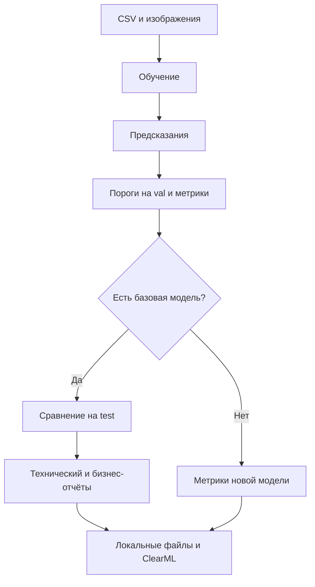

# clearml-yolo

Обучает модели детекции по CSV с разметкой и сохраняет веса, метрики и отчёты
в ClearML. Можно запустить только обучение, а можно весь эксперимент: обучение,
предсказания, подбор порогов, оценку и сравнение с прежней моделью.

Поддерживаются YOLO (Ultralytics), DEIMv2, RF-DETR, Faster R-CNN и FCOS.

## Установка

Нужны:

- Linux с поддержкой pidfd, Python `>=3.12.13,<3.14` и установленный `uv`;
- настроенный доступ к ClearML с хранилищем артефактов — без ClearML команды
  обучения и оценки не работают;
- исходники `digital-metrics` и `report-generator` утверждённых ревизий; ревизии
  перечислены в [руководстве по разработке](docs/development.md#external-dependencies).

Пакет ставится из исходников, в PyPI его нет. Скопируйте обе зависимости
в `external/digital-metrics` и `external/report-generator`, затем из корня репозитория:

```bash
uvx --from go-task-bin task local-deps   # собирает external/wheelhouse и создаёт uv.toml
uv sync --locked --dev
uv run --locked cy --help
source .venv/bin/activate
```

Зависимости всех моделей и ONNX-экспорта ставятся сразу, extras нет. Очередь заданий —
отдельный пакет [cy-queue](https://github.com/BuckanovNikita/cy-queue). Требования
к окружению подробнее описаны в [техническом справочнике](TECH_DETAILS.md#setup).

## Первое обучение

Подготовьте CSV с разметкой: одна строка — один объект, координаты углов рамки
в пикселях.

```csv
image_name,image_path,instance_label,bbox_x_tl,bbox_y_tl,bbox_x_br,bbox_y_br,split
train.jpg,images/train.jpg,helmet,10,20,100,120,train
val.jpg,images/val.jpg,helmet,10,20,100,120,val
test.jpg,images/test.jpg,helmet,10,20,100,120,test
```

Запустите обучение. Проект, имя задачи и теги ClearML указываются явно:

```bash
cy-train ground_truth=./ground_truth.csv ultralytics.model=yolo11n.pt ultralytics.device=0 \
  clearml.project_name=detection clearml.task_name=yolo11n-train 'clearml.tags=[yolo,training]'
```

Для остальных семейств модель выбирается через `model=`, а параметры обучения
начинаются с `model.train.`:

```bash
cy-train model=rfdetr/small ground_truth=./ground_truth.csv model.train.device=0 \
  clearml.project_name=detection clearml.task_name=rfdetr-small-train 'clearml.tags=[rfdetr,training]'
```

Команда стартует сразу и не ждёт, пока GPU освободится. Для CPU замените `0` на `cpu`:
`ultralytics.device=cpu` или `model.train.device=cpu`.

Ход обучения виден в задаче ClearML на вкладках `Console`, `Scalars` и `Plots`,
лучшие веса — в `Output Models`. Локальные файлы лежат
в `runs/<проект>/<задача>-<task-id>/`; точный путь к весам есть в журнале.

## Данные

Правила для CSV:

- Несколько объектов на изображении — несколько строк с одним и тем же изображением.
  Изображение без объектов — одна строка с пустыми классом и координатами.
- `image_name` совпадает с именем файла. Относительный `image_path` считается
  от каталога, где лежит CSV.
- Выборки `train`, `val` и `test` назначаете вы. `cy-train` нужны `train` и `val`,
  полному `cy` — ещё и `test`.
- Имена классов читаются буквально: `NA`, `None`, `nan` и числа остаются именами
  классов, а не пропусками.
- Некорректные рамки отбрасываются с сообщением. Если в `train` не осталось ни одной
  рамки, обучение не начнётся.

Вместо локального файла можно сослаться на финализированный ClearML Dataset, по ID
либо по проекту и имени:

```bash
cy-train 'ground_truth={dataset_id:DATASET_ID}' ultralytics.model=yolo11n.pt ultralytics.device=0 \
  clearml.project_name=detection clearml.task_name=dataset-train 'clearml.tags=[training]'

cy-train 'ground_truth={project_name:annotations,name:ground-truth,version:"1.2.0"}' \
  ultralytics.model=yolo11n.pt ultralytics.device=0 \
  clearml.project_name=detection clearml.task_name=versioned-train 'clearml.tags=[training]'
```

В наборе должен лежать один файл `dataset.csv`. Изображения в набор не входят:
пути из CSV должны быть доступны на машине, где идёт обучение. Без `version` каждый
новый запуск берёт версию, которую выберет ClearML, и она может оказаться другой.

Формат и все проверки описаны в [контракте входных данных](docs/input-provenance.md).
Если разметка в формате YOLO, её переводит в CSV [`cy-ground-truth`](#другие-команды).

## Модели и параметры

| Семейство | Значения `model=` |
| --- | --- |
| YOLO | `ultralytics` (по умолчанию); `ultralytics.model` обязателен — файл весов или архитектуры |
| DEIMv2 | `deimv2/s`, `deimv2/m`, `deimv2/l`, `deimv2/x` |
| RF-DETR | `rfdetr/nano`, `rfdetr/small`, `rfdetr/medium`, `rfdetr/large` |
| Faster R-CNN | `fasterrcnn/resnet50_fpn`, `fasterrcnn/resnet101_fpn`, `fasterrcnn/convnext_tiny`, `fasterrcnn/swin_tiny`, `fasterrcnn/dinov2_small`, `fasterrcnn/dinov3_small` |
| FCOS | `fcos/resnet50_fpn`, `fcos/resnet101_fpn`, `fcos/convnext_tiny`, `fcos/swin_tiny`, `fcos/dinov2_small`, `fcos/dinov3_small` |

| Что изменить | YOLO | Остальные семейства |
| --- | --- | --- |
| Число эпох | `ultralytics.epochs=50` | `model.train.epochs=50` |
| Размер пакета | `ultralytics.batch=8` | `model.train.batch=8` |
| Размер изображения | `ultralytics.imgsz=640` | `model.train.imgsz=640` |
| Устройство | `ultralytics.device=0` | `model.train.device=0` |
| Начальные веса | `ultralytics.model=./best.pt` | `model.train.weights=./best.pth` |

Для YOLO модель нужно указать всегда, у остальных семейств её задаёт пресет. По
умолчанию обучение начинается с предобученных весов. Если их не удалось получить или
они не подходят модели, команда завершится с ошибкой, а не возьмёт случайные.
Указанные вами веса — это начало нового обучения: продолжить прерванное (`resume`)
нельзя. Для RF-DETR и DEIMv2 размер изображения должен быть квадратным и кратным 32,
для DEIMv2 — ещё и не меньше 128.

Исходники и веса DEIMv2 скачиваются при первом запуске. Что делать в сети без
доступа к GitHub, описано в разделе [Веса без доступа к сети](#веса-без-доступа-к-сети).
Остальные особенности семейств — в [руководстве по моделям](docs/multi-model-backends.md).

### Размер пакета из таблицы

Если не хочется подбирать размер пакета вручную, задайте `ultralytics.batch=null`
или `model.train.batch=null`. Значение возьмётся из таблицы `CY_HOME/.config/clearml-yolo/batch-sizes.yaml`, где для GPU,
размера изображения и модели записан размер пакета на одну GPU:

```yaml
"NVIDIA GeForce RTX 4090 [24 GiB]":
  960:
    ultralytics/yolo11n: 32
    rfdetr/small: 3
```

Таблицу можно заполнить вручную или измерением на свободных GPU:

```bash
cy-batch-estimate --imgsz 960
cy-batch-estimate --imgsz 960 --models rfdetr/small,fcos/resnet50_fpn --devices 0,1
cy-batch-estimate --list
```

```bash
cy-train ground_truth=./ground_truth.csv ultralytics.model=yolo11n.pt \
  ultralytics.imgsz=960 ultralytics.device=0 ultralytics.batch=null \
  clearml.project_name=detection clearml.task_name=yolo-estimated 'clearml.tags=[training]'
```

Если для вашей GPU записи нет, берётся запись GPU с памятью не больше вашей, и команда
об этом предупреждает. При обучении на нескольких GPU общий размер пакета равен числу
GPU, умноженному на наименьшее значение среди них. Значение из таблицы — рекомендация:
при нехватке памяти обучение упадёт и само с меньшим пакетом не перезапустится.
Для CPU и неквадратных изображений размер пакета задаётся числом. Подробности —
в [руководстве по оценке batch](docs/batch-estimation.md).

### Свои аугментации

Все модели принимают набор аугментаций Albumentations, сохранённый в JSON:

```python
from pathlib import Path

import albumentations as A

pipeline = A.Compose(
    [A.HorizontalFlip(p=0.5), A.RandomBrightnessContrast(p=0.2)],
    bbox_params=A.BboxParams(format="pascal_voc", label_fields=["class_labels"]),
)
A.save(pipeline, Path("augmentation.json"))
```

```bash
cy-train model=rfdetr/nano ground_truth=./ground_truth.csv \
  transforms=albumentations transforms.pipeline_file=./augmentation.json \
  model.train.device=0 model.train.epochs=20 \
  clearml.project_name=detection clearml.task_name=rfdetr-custom \
  'clearml.tags=[rfdetr,custom-augmentation]'
```

Свой набор заменяет встроенные случайные аугментации модели. Приведение к размеру
и нормализацию модель делает сама, поэтому `Normalize`, `ToFloat` и `ToTensorV2`
в JSON не нужны. Для Mosaic поставьте `A.Mosaic(...)` первым в `A.Compose`.
Готовые примеры: [flip.json](examples/augmentation/flip.json),
[mosaic.json](examples/augmentation/mosaic.json). Остальное —
в [руководстве по аугментациям](docs/augmentation.md).

## Полный эксперимент

`cy` обучает модель, получает предсказания, подбирает пороги на `val`, считает метрики
и, если есть базовая модель, сравнивает с ней новую на текущей выборке `test`.

```bash
cy ground_truth=./ground_truth.csv ultralytics.model=yolo11n.pt \
  ultralytics.epochs=50 ultralytics.device=0 ultralytics_predict.device=0 \
  run_dir=./runs/experiment-01 clearml.project_name=detection \
  clearml.task_name=yolo11n-experiment 'clearml.tags=[yolo,experiment]'
```

Устройства для обучения и предсказаний задаются отдельно. У остальных семейств это
`model.train.device` и `model.predict.device`.



Базовая модель — последняя завершённая задача с тегом `prod` в том же проекте ClearML.
Её можно указать явно: `compare.baseline_model.task_id=BASELINE_TASK_ID`. Если базовой
модели нет, сравнение и отчёты пропускаются. Обе модели оцениваются на одних и тех же
текущих изображениях: старая заново предсказывает на `test`, прошлые метрики
не переиспользуются.

| Результат | Где искать |
| --- | --- |
| Настройки, журнал, ход обучения | `Configuration`, `Console`, `Scalars`, `Plots` задачи ClearML |
| Лучшие веса | `Output Models`; локальный путь указан в журнале |
| Разметка и предсказания | артефакты `gt_csv` и `predicts_csv` |
| Пороги, метрики, графики | артефакты и `Plots` |
| Сравнение и отчёты | XLSX-файлы, если сравнение состоялось |
| Файлы запуска | `run_dir` или `runs/<проект>/<задача>-<task-id>/` |

Для нового эксперимента берите новый каталог. Выходные каталоги (`run_dir`,
`output_dir`), кэш и журналы должны находиться внутри `CY_HOME` — по умолчанию это
каталог запуска. Входные данные могут лежать где угодно.

Если обучение прошло успешно и проверенные веса сохранены, а что-то после него не удалось, в том числе загрузка
в ClearML, `cy` завершается с предупреждением и записывает случившееся
в `pipeline_outcome.json`. В отдельных командах сбой загрузки — это ошибка. Локальные
файлы остаются в обоих случаях. Прерывание запуска, ошибка обучения и ошибки при
`skip_train=true` завершают команду с ненулевым кодом возврата.

Запускайте команды из Git-репозитория, чтобы сохранялась история конфигурации.
Вне репозитория команда работает, но предупреждает об этом.

## Отдельные шаги

Любой шаг эксперимента запускается и сам по себе. Каждая команда создаёт свою задачу
ClearML. В примерах используется чекпойнт YOLO; для других семейств добавьте `model=...`
и замените `ultralytics_predict.device` на `model.predict.device`.

Предсказания по готовым весам:

```bash
cy-predict weights=./best.pt ground_truth=./ground_truth.csv 'splits=[val,test]' \
  model_label=local-yolo ultralytics_predict.device=0 output=./predictions/predictions.csv \
  clearml.project_name=detection clearml.task_name=yolo-predict 'clearml.tags=[prediction]'
```

Предсказания, пороги и метрики за один запуск:

```bash
cy-val weights=./best.pt ground_truth=./ground_truth.csv 'splits=[val,test]' \
  model_label=local-yolo ultralytics_predict.device=0 output_dir=./validation \
  clearml.project_name=detection clearml.task_name=yolo-val 'clearml.tags=[validation]'
```

Метрики по уже готовой таблице предсказаний, без запуска модели:

```bash
cy-metrics ground_truth=./ground_truth.csv predictions=./predictions/predictions.csv \
  'splits=[val,test]' model_label=local-yolo output_dir=./metrics \
  clearml.project_name=detection clearml.task_name=yolo-metrics 'clearml.tags=[metrics]'
```

Сравнение двух моделей на текущей разметке и отчёты по нему:

```bash
cy-compare ground_truth=./ground_truth.csv baseline_model.task_id=BASELINE_TASK_ID \
  candidate_model.task_id=CANDIDATE_TASK_ID ultralytics_predict.device=0 \
  output_dir=./comparison clearml.project_name=detection \
  clearml.task_name=paired-comparison 'clearml.tags=[comparison]'

cy-report comparison_dir=./comparison output_dir=./reports \
  clearml.project_name=detection clearml.task_name=paired-reports 'clearml.tags=[reports]'
```

Что стоит знать:

- `cy-val` и `cy-metrics` подбирают пороги на `val`, даже если оценивается только
  `test`. `cy-compare` пороги не подбирает, а берёт сохранённые у каждой модели.
- `model_label` — подпись модели в таблицах и отчётах. Она нужна, когда у весов или
  предсказаний нет сведений о том, откуда они взялись.
- Эти сведения хранятся рядом с файлами: `<checkpoint>.identity.json` у весов
  и `<predictions.csv>.provenance.json` у предсказаний. Переносите их вместе с файлами.
- `cy-compare` может взять модели не из ClearML, а из локальных весов: `source=local`,
  `weights` и `thresholds` у каждой ссылки. Пороги нужны по всем классам и из
  собственной калибровки модели;
  см. [правила ModelRef](docs/multi-model-backends.md#data-checkpoints-and-comparison).
- `cy-report` работает только с каталогом, который создал `cy-compare`.

Форматы таблиц и правила оценки — в [техническом справочнике](TECH_DETAILS.md#inputs-and-evaluation).

## Конфигурация в YAML

Когда параметров становится много, сохраните их в файлы:

```bash
cy-init-config cy-config
```

Появятся `cy-config/cy.yaml` и файлы с параметрами обучения и предсказаний. Общие
настройки правятся в `cy.yaml`, список `defaults` в нём трогать не нужно:

```yaml
ground_truth: ./ground_truth.csv
clearml:
  project_name: detection
  task_name: yolo11n-configured
  tags: [configured, experiment]
```

Параметры обучения — в `cy-config/ultralytics/default.yaml`, без обёртки `ultralytics:`:

```yaml
model: yolo11n.pt
epochs: 50
imgsz: 640
batch: 8
device: 0
```

Параметры предсказаний (`batch`, `conf`, `iou`, `device`) лежат так же
в `cy-config/ultralytics_predict/default.yaml`. Здесь `conf` и `iou` управляют самими
предсказаниями; пороги итоговой оценки подбираются отдельно.

```bash
cy --config-dir cy-config --config-name cy
cy --config-dir cy-config --config-name cy ultralytics.epochs=20   # переопределить один параметр
cy --config-dir cy-config --config-name cy --cfg job --resolve     # показать итоговую конфигурацию
```

Конфигурация для другой команды или семейства создаётся так:

```bash
cy-init-config train-config --command cy-train --model rfdetr/small
cy-train --config-dir train-config --config-name cy-train
```

`cy-init-config` не перезаписывает существующие файлы без `--force`. Как перенести
настройки из старой версии, описано в [разделе о миграции](TECH_DETAILS.md#configuration-and-migration).

### Перебор параметров и несколько GPU

Перебор запускается флагом `-m`, варианты выполняются по очереди:

```bash
cy --config-dir cy-config --config-name cy -m ultralytics.epochs=10,20
```

Все задачи одного перебора получают общий тег с датой и случайной фразой, по которому
их легко найти в ClearML.

Для обучения на нескольких GPU перечислите устройства; предсказания идут на одной:

```bash
cy --config-dir cy-config --config-name cy 'ultralytics.device=[0,1]' ultralytics_predict.device=0
```

У остальных семейств это `'model.train.device=[0,1]'`, а `model.train.batch` должен
делиться на число GPU. Для них обучение на нескольких GPU пока не проверено на
реальном оборудовании; подробнее —
в [руководстве по моделям](docs/multi-model-backends.md#devices-scheduling-and-replay).

## Веса без доступа к сети

Все нужные веса можно скачать заранее:

```bash
cy-download-weights
```

Команда готовит веса YOLO, RF-DETR, backbone для Faster R-CNN и FCOS, а также DEIMv2
`s` и `m` вместе с исходниками. Файлы берутся из релиза весов этого проекта на GitHub
и проверяются по контрольным суммам. Повторный запуск докачивает только недостающее.
Если что-то скачать не удалось, код возврата ненулевой.

DEIMv2 `l` и `x` в общую подготовку не входят и скачиваются при выборе этой модели:
исходники — с GitHub, backbone DINOv3 — с Hugging Face, где нужно принять лицензию
и задать `HF_TOKEN`. Прокси для этого пути задают переменные `GH` и `HF_ENDPOINT`;
см. [описание источников](docs/model-assets.md#ordinary-selected-model-source-routes).

При первом запуске `cy` та же подготовка выполняется сама. Если она прошла не
полностью, `cy` предупредит и продолжит работу с выбранной моделью. Отдельные команды
вроде `cy-train` общую подготовку не запускают.

Если GitHub недоступен напрямую, укажите прокси. `GHR` — корень Generic-репозитория
Artifactory, который проксирует `https://github.com`:

```bash
export GHR="https://artifactory.example/artifactory/github-files"
export CY_WEIGHTS_DOWNLOAD_TIMEOUT=3600   # необязательно: секунд на один архив, по умолчанию 1800
cy-download-weights
```

Авторизация настраивается через `.netrc`, собственный сертификат — через
`SSL_CERT_FILE` или `REQUESTS_CA_BUNDLE`. Ответ 401 означает, что не прошла авторизация,
403 — что нет прав, 404 — что неверен путь или файл недоступен в источнике.
Если нет ни сети, ни прокси, файлы можно разложить вручную: когда команде обучения
не удаётся загрузить модель, сообщение об ошибке перечисляет недостающие файлы,
их исходные адреса и пути, куда их положить. Всё это подробно разобрано
в [руководстве по весам](docs/model-assets.md).

Лицензии у весов разные: YOLO — AGPL-3.0, DEIMv2 — только некоммерческое использование,
DINOv3 — отдельное соглашение Meta с ограничениями. Тексты лицензий лежат в архивах.

**Built with DINOv3.** Backbone DINOv3 распространяется в неизменённом формате
конвертации timm, с исходной конфигурацией и метаданными ревизии.

## Запуск через ClearML Agent и очередь

Задачу можно выполнить через ClearML Agent: настройки берутся из сохранённой в задаче
конфигурации `run`, повторять аргументы командной строки не нужно. Зависимости
ставит ваше окружение Agent, а GPU он выбирает через `CUDA_VISIBLE_DEVICES`.
Подробности — в [описании запуска через Agent](docs/runtime-isolation.md#clearml-agent-execution).

Если одну машину с GPU делят несколько запусков или людей, пригодится
[cy-queue](https://github.com/BuckanovNikita/cy-queue). Это отдельный пакет: он хранит
задания, ждёт свободные GPU и запускает `cy` или `cy-train`.

```bash
cy-queue submit --gpus 1 -- --config-dir cy-config --config-name cy
cy-queue worker
```

Перед отправкой уберите устройства из YAML (`device: null`): GPU назначает очередь.
Установка, настройка и команды описаны в README `cy-queue`, правила для администратора
общей очереди — в [руководстве оператора](docs/queue.md).

## Другие команды

Разметку YOLO (`data.yaml` и изображения) переводит в CSV `cy-ground-truth`. Если
в источнике нет `test`, под него выделяется часть `val`; проверьте разбиение перед
обучением.

```bash
cy-ground-truth data_yaml=./dataset/data.yaml output=./converted/ground_truth.csv \
  test_fraction=0.5 seed=0 clearml.project_name=detection \
  clearml.task_name=convert-ground-truth 'clearml.tags=[conversion]'
```

Чекпойнт Faster R-CNN экспортируется в ONNX командой `cy-export`. Экспорт других
семейств не поддерживается. Сборка и проверка TensorRT описаны
в [руководстве по TensorRT](docs/tensorrt-deployment.md).

```bash
cy-export model=fasterrcnn/resnet50_fpn weights=./best.pth \
  export.operation=onnx export.device=cpu export.precision=fp32 output_dir=./exported \
  clearml.project_name=detection clearml.task_name=fasterrcnn-onnx 'clearml.tags=[export]'
```

`cy-dedup` освобождает место в кэше изображений (`$CY_HOME/.cache`): на файловой
системе с reflink одинаковые файлы начинают занимать место один раз. Сначала остановите
запись в кэш и посмотрите, что будет сделано:

```bash
cy-dedup --dry-run
cy-dedup
```

Изображения, разметку и предсказания можно просматривать в FiftyOne — искать пропуски
и ложные срабатывания. Как открыть опубликованный набор, описано
в [техническом справочнике](TECH_DETAILS.md#open-a-published-fiftyone-dataset).

## Если запуск не удался

| Проблема | Что проверить |
| --- | --- |
| Не найдены изображения или выборка | Пути относительно CSV; наличие `train` и `val`, а для `cy` — ещё и `test` |
| Нет записи batch | Добавьте запись в `batch-sizes.yaml`, запустите `cy-batch-estimate` или задайте размер пакета числом |
| Неизвестный параметр | Префикс группы (`ultralytics.`, `model.train.`); сверьтесь со свежим YAML из `cy-init-config` |
| Не загружается модель | Семейство, пресет и совместимость весов; сообщение об ошибке называет [недостающие файлы и пути для них](docs/model-assets.md#offline-placement-and-access) |
| Требуется подпись модели | Передайте `model_label`; сохраните файлы `.identity.json` и `.provenance.json` |
| Нет сравнения и отчётов | Есть ли завершённая задача с тегом `prod` или верна ли явная ссылка на базовую модель |
| Очередь не запускает задание | Запущен ли ваш worker и хватает ли свободных GPU; прямая команда GPU не ждёт |
| Ошибка ClearML или загрузки | Доступ к серверу и хранилищу, локальный журнал и `pipeline_outcome.json`; в `cy` после успешного обучения это предупреждение, в отдельных командах — ошибка |

Подробность журнала задаёт `LOGURU_LEVEL`: `INFO` — коротко, `DEBUG` — со стеком ошибок
(по умолчанию), `TRACE` — для разбора зависаний. Чтобы остановить запуск, нажмите
`Ctrl+C` и дождитесь, пока завершатся дочерние процессы.

Если обучение закончилось и веса сохранены, ошибка на следующем шаге результат обучения
не отменяет. Что именно не выполнилось, написано в `pipeline_outcome.json` и в итоговой
сводке. Успешный код возврата с предупреждениями не значит, что готовы все отчёты.
Прерывание запуска, ошибка обучения и ошибки при `skip_train=true` остаются
ошибками с ненулевым кодом возврата.

Больше приёмов — в [руководстве по диагностике](docs/diagnostics.md).

## Разработка

Окружение ставится так же, как в разделе [Установка](#установка), для каждого рабочего
дерева отдельно. После этого установите Git-хуки:

```bash
bash scripts/install-hooks.sh
```

Проверки запускаются через Task:

```bash
uv run --locked task --exit-code fix         # автоисправления Ruff и форматирование
uv run --locked task --exit-code verify      # статические проверки и затронутые тесты
uv run --locked task --exit-code acceptance  # полная приёмка чистого коммита
```

Хук перед коммитом запускает `verify` и не пропускает коммит, если в рабочем дереве
есть изменения или новые файлы вне индекса. Сообщения коммитов — в формате
Conventional Commits. Остальное — в [руководстве по разработке](docs/development.md).

## Документация

Вся подробная документация написана на английском.

- [TECH_DETAILS.md](TECH_DETAILS.md) — технический справочник.
- [docs/current-contracts.md](docs/current-contracts.md) — указатель по всем описаниям поведения.
- [docs/multi-model-backends.md](docs/multi-model-backends.md) — семейства моделей.
- [docs/input-provenance.md](docs/input-provenance.md) — входные данные и происхождение результатов.
- [docs/model-assets.md](docs/model-assets.md) — веса, кэши, прокси.
- [docs/queue.md](docs/queue.md) — очередь.
- [docs/diagnostics.md](docs/diagnostics.md) — диагностика.
- [docs/development.md](docs/development.md) — разработка и релизы.
