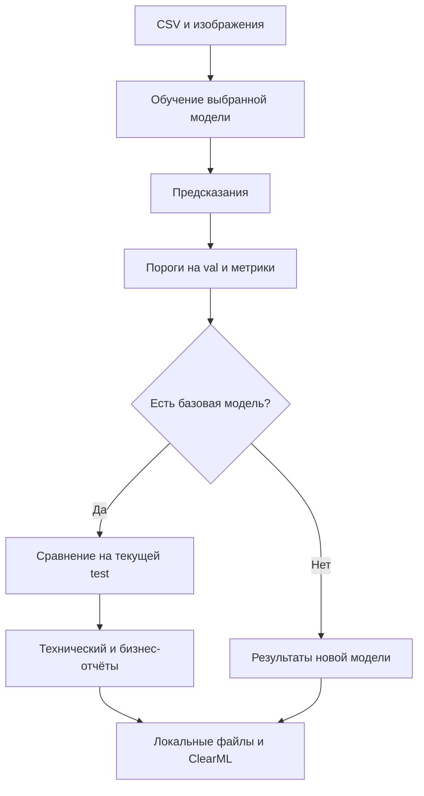

# clearml-yolo

`clearml-yolo` обучает модели детекции по CSV с разметкой, сохраняет лучшие веса
и результаты эксперимента в ClearML. Можно запустить только обучение или весь
процесс: предсказания, подбор порогов, оценку, сравнение моделей и отчёты.

## Обучение одной командой

Нужны установленный пакет для Python `>=3.12.13,<3.14` (Python 3.12 начиная с 3.12.13
или Python 3.13), настроенный доступ к ClearML с хранилищем артефактов, изображения
и CSV с выборками `train` и `val`. Для нативных запусков сборка Python и ядро Linux
должны поддерживать pidfd; одного номера версии недостаточно. Для DEIMv2, RF-DETR и
Faster R-CNN нужны зависимости `detectors`; [установка и настройка](TECH_DETAILS.md#setup)
описаны отдельно. Ниже выбран GPU `0`; для CPU замените соответствующий `device=0`
на `device=cpu`. Прямые команды начинают работу сразу и не ждут свободного GPU.

Замените пути на свои, а проект, имя задачи и теги — на обозначения эксперимента.
Каждая строка запускает самостоятельное обучение, без предварительного создания YAML.

**YOLO:**

```bash
cy-train ground_truth=./ground_truth.csv ultralytics.model=yolo11n.pt ultralytics.device=0 clearml.project_name=detection clearml.task_name=yolo11n-train 'clearml.tags=[yolo,training]'
```

**DEIMv2:** подготовьте [исходники утверждённой ревизии и совместимые веса](docs/multi-model-backends.md#deimv2-source-and-initialization).
`deimv2-s-backbone.pth` здесь — путь к уже полученным весам backbone для пресета S,
а не имя для автоматического скачивания.

```bash
cy-train model=deimv2/s ground_truth=./ground_truth.csv model.source_dir=./vendor/DEIMv2 model.train.backbone_weights=./weights/deimv2-s-backbone.pth model.train.device=0 clearml.project_name=detection clearml.task_name=deimv2-s-train 'clearml.tags=[deimv2,training]'
```

**RF-DETR:**

```bash
cy-train model=rfdetr/small ground_truth=./ground_truth.csv model.train.device=0 clearml.project_name=detection clearml.task_name=rfdetr-small-train 'clearml.tags=[rfdetr,training]'
```

**Faster R-CNN:**

```bash
cy-train model=fasterrcnn/resnet50_fpn ground_truth=./ground_truth.csv model.train.device=0 clearml.project_name=detection clearml.task_name=fasterrcnn-train 'clearml.tags=[fasterrcnn,training]'
```

После обучения откройте указанную задачу в проекте ClearML `detection`: ход обучения
находится в `Console`, `Scalars` и `Plots`, лучший чекпойнт — в `Output Models`.
Локальные файлы по умолчанию находятся в `runs/<проект>/<задача>-<task-id>/`;
точный путь к весам смотрите в журнале. Для YOLO это `best.pt`, у других семейств
имя и расширение определяет нативный backend.

## Повседневное обучение

### CSV и выборки

Вход `ground_truth` — CSV с абсолютными координатами углов рамки в пикселях:

```csv
image_name,image_path,instance_label,bbox_x_tl,bbox_y_tl,bbox_x_br,bbox_y_br,split
train.jpg,images/train.jpg,helmet,10,20,100,120,train
val.jpg,images/val.jpg,helmet,10,20,100,120,val
test.jpg,images/test.jpg,helmet,10,20,100,120,test
```

Это пример разметки существующих изображений. Одна строка описывает один объект;
для нескольких объектов повторите изображение. Для изображения без объектов
оставьте класс и координаты пустыми, не смешивая такую строку с рамками этого изображения.
`image_name` должен совпадать с именем файла. Пути к изображениям считаются от
каталога CSV, а путь самого CSV — от каталога запуска команды.

Строковые классы `NA`, `NULL`, `nan`, `None`, числовые строки и Unicode сохраняются
буквально; пустая ячейка остаётся признаком фона. Это правило действует также при
чтении кэша и публикации результатов. Относительные пути берутся из каталога CSV
и при отдельном предсказании, сравнении или `skip_train=true`, включая смену каталога Hydra.
Для оценки и сравнения требуется `image_name=name`; `stem` и `path` допустимы только
для экспорта сырых предсказаний. Неизвестные имена изображений вызывают ошибку до оценки.
Подробности и схема происхождения данных — в [контракте входов](docs/input-provenance.md).

`cy-train` требует непустые `train` и `val`; **полный `cy` по умолчанию требует ещё
и `test`**. Разбиение задаёте вы: команды обучения его не создают. Классы и состав
набора берутся из CSV, данные YOLO или COCO готовятся автоматически. Некорректные
рамки отбрасываются с сообщением; отсутствие допустимых обучающих рамок — ошибка.
Подробности — [контракт входных данных](specs/004-ground-truth-training/contracts/cli.md).

### Модель и параметры

| Семейство | Все поддерживаемые значения `model=` |
| --- | --- |
| YOLO | `ultralytics` (по умолчанию); веса или архитектура задаются через `ultralytics.model` |
| DEIMv2 | `deimv2/s`, `deimv2/m`, `deimv2/l`, `deimv2/x` |
| RF-DETR | `rfdetr/nano`, `rfdetr/small`, `rfdetr/medium`, `rfdetr/large` |
| Faster R-CNN + ResNet FPN | `fasterrcnn/resnet50_fpn`, `fasterrcnn/resnet101_fpn` |
| Faster R-CNN + ConvNeXt/Swin | `fasterrcnn/convnext_tiny`, `fasterrcnn/swin_tiny` |
| Faster R-CNN + DINO | `fasterrcnn/dinov2_small`, `fasterrcnn/dinov3_small` |

Добавляйте параметры к выбранной команде обучения:

| Что изменить | YOLO | DEIMv2, RF-DETR, Faster R-CNN |
| --- | --- | --- |
| Число эпох | `ultralytics.epochs=50` | `model.train.epochs=50` |
| Размер пакета | `ultralytics.batch=8` | `model.train.batch=8` |
| Размер изображения | `ultralytics.imgsz=640` | `model.train.imgsz=640` |
| Устройство | `ultralytics.device=0` | `model.train.device=0` |
| Начать обучение из весов | `ultralytics.model=./best.pt` | `model.train.weights=./best.pth` |

Размер RF-DETR должен быть квадратным и кратным 32. Размеры по умолчанию и
ограничения backbone приведены в [руководстве по моделям](docs/multi-model-backends.md).
Для YOLO нужно явно задать `ultralytics.model`; у остальных семейств выбирается пресет.
По умолчанию запрашивается pretrained-инициализация. Недоступные или несовместимые
веса вызывают ошибку; скрытого перехода на другую модель или случайные веса нет.

Например, обучение YOLO с изменёнными параметрами:

```bash
cy-train ground_truth=./ground_truth.csv ultralytics.model=yolo11n.pt \
  ultralytics.epochs=50 ultralytics.batch=8 ultralytics.imgsz=640 ultralytics.device=0 \
  clearml.project_name=detection clearml.task_name=yolo11n-50ep 'clearml.tags=[yolo,experiment]'
```

Загрузка готовых весов начинает новое обучение; `resume` в CSV-режиме не поддерживается.
Нативные `data`, `classes`, `fraction` и `single_cls` не заменяют выборку из CSV.
Если переносите параметры из Ultralytics, используйте префикс `ultralytics.`;
[различия настроек и миграция](TECH_DETAILS.md#configuration-and-migration) описаны отдельно.

## Полный эксперимент

`cy` связывает обучение с предсказаниями, калибровкой порогов на `val` и оценкой
через `digital-metrics`. При наличии базовой модели он сравнивает её с новой
на текущей выборке `test` и создаёт отчёты через `report-generator`.

```bash
cy ground_truth=./ground_truth.csv ultralytics.model=yolo11n.pt \
  ultralytics.epochs=50 ultralytics.device=0 ultralytics_predict.device=0 \
  run_dir=./runs/experiment-01 clearml.project_name=detection \
  clearml.task_name=yolo11n-experiment 'clearml.tags=[yolo,experiment]'
```

Для другого семейства выберите `model=...` и используйте `model.train.*` /
`model.predict.*`, как в обучении. Устройство обучения и предсказаний задаётся отдельно.



По умолчанию базовая модель берётся из последней завершённой задачи с тегом `prod`
в том же проекте ClearML, исключая текущую задачу. Если такой задачи нет, остаются
предсказания, метрики и графики новой модели; сравнение и парные отчёты пропускаются.
Для явного выбора добавьте `compare.baseline_model.task_id=BASELINE_TASK_ID`.
Ошибка загрузки явно выбранной модели завершает команду с ошибкой.

В новом эксперименте старая модель заново предсказывает на текущих `test`-изображениях.
Метрики обеих моделей считаются по одной актуальной разметке и согласованным
настройкам предсказаний. Сохранённые веса и пороги базовой модели остаются прежними;
новые пороги подбираются только на `val`. При повторе в том же каталоге с теми же
входами и настройками предсказания могут браться из кэша, метрики пересчитываются.

| Результат | Где искать |
| --- | --- |
| Настройки, журнал и ход обучения | `Configuration`, `Console`, `Scalars`, `Plots` одной задачи ClearML |
| Лучшие веса | `Output Models`; локальный путь указан в журнале |
| Разметка и предсказания | Артефакты `gt_csv` и `predicts_csv` |
| Пороги, метрики и графики | Артефакты порогов, книги метрик и `Plots` |
| Парное сравнение и отчёты | XLSX после успешного сравнения с базовой моделью |
| Файлы запуска | `run_dir` либо `runs/<проект>/<задача>-<task-id>/` |

Используйте новый каталог для нового эксперимента. `CY_HOME` задаёт рабочий корень
(по умолчанию каталог запуска); выходы, кэш и журналы должны оставаться внутри него.
Входные данные могут находиться снаружи. Сбой обязательной загрузки в ClearML
завершает запуск с ошибкой, сохраняя локальные результаты.

## Отдельные рабочие процессы

Каждая команда ниже создаёт свою задачу ClearML. Замените пути и идентификаторы
на реальные. Примеры с локальным `best.pt` предполагают YOLO-чекпойнт.

### Предсказания — `cy-predict`

Нужны веса и CSV, задающий изображения. Команда сохраняет таблицу рамок, классов
и уверенности; параметр `splits` ограничивает выборки.

```bash
cy-predict weights=./best.pt ground_truth=./ground_truth.csv 'splits=[val,test]' \
  model_label=local-yolo ultralytics_predict.device=0 output=./predictions/predictions.csv \
  clearml.project_name=detection clearml.task_name=yolo-predict 'clearml.tags=[prediction]'
```

Результат — указанный CSV, файл происхождения рядом с ним и артефакт `predicts_csv`.
Для нового семейства укажите его `model=...` и `model.predict.device=0` вместо
`ultralytics_predict.device=0`; DEIMv2 также требует `model.source_dir`.

### Проверка модели — `cy-val`

Нужны готовые веса, разметка и `val` для подбора порогов. Команда получает
предсказания, фиксирует пороги на `val` и оценивает выбранные выборки.

```bash
cy-val weights=./best.pt ground_truth=./ground_truth.csv 'splits=[val,test]' \
  model_label=local-yolo ultralytics_predict.device=0 output_dir=./validation \
  clearml.project_name=detection clearml.task_name=yolo-val 'clearml.tags=[validation]'
```

В `output_dir` сохраняются предсказания, пороги, книги метрик и графики; результаты
публикуются в ClearML. `val` используется для калибровки даже при оценке только `test`.

### Метрики по таблицам — `cy-metrics`

Нужны CSV разметки и предсказаний для `val` и оцениваемых выборок. Обучение и
инференс не запускаются. Пороги подбираются на `val` (`calibration_split=val`)
и затем применяются к остальным выборкам.

```bash
cy-metrics ground_truth=./ground_truth.csv predictions=./predictions/predictions.csv \
  'splits=[val,test]' model_label=local-yolo output_dir=./metrics \
  clearml.project_name=detection clearml.task_name=yolo-metrics 'clearml.tags=[metrics]'
```

Результат — пороги, книги метрик и графики в `output_dir` и ClearML. Команда не
создаёт и не изменяет зарегистрированную модель. Формат таблиц и правила оценки —
в [техническом справочнике](TECH_DETAILS.md#inputs-and-evaluation).

### Сравнение двух моделей — `cy-compare`

Нужны текущая разметка и две ссылки на модели с сохранёнными порогами. По умолчанию
сравнение идёт на `test`. В примере веса и пороги восстанавливаются из задач ClearML:

```bash
cy-compare ground_truth=./ground_truth.csv baseline_model.task_id=BASELINE_TASK_ID \
  candidate_model.task_id=CANDIDATE_TASK_ID ultralytics_predict.device=0 \
  output_dir=./comparison clearml.project_name=detection \
  clearml.task_name=paired-comparison 'clearml.tags=[comparison]'
```

Обе модели получают одни и те же текущие изображения; исторические метрики не
подменяют новую оценку. Результат — парные книги метрик, таблицы сравнения и
`comparison_manifest.json` в `output_dir`, необходимые следующему шагу.

Для локальных весов задайте у каждой ссылки `source=local`, `weights`, `label`
при неизвестном происхождении и `thresholds` с точными порогами всех классов.
Берите пороги из калибровки этой модели, не придумывайте общий порог.
Модели могут принадлежать разным семействам. Для внешних нативных весов без метаданных
нужны также backend, пресет, упорядоченные классы и preprocessing; см.
[правила ModelRef](docs/multi-model-backends.md#data-checkpoints-and-comparison).

### Отчёты — `cy-report`

Нужен каталог `cy-compare` с манифестом и обеими оценёнными книгами, а не произвольные
метрики прежних экспериментов.

```bash
cy-report comparison_dir=./comparison output_dir=./reports \
  clearml.project_name=detection clearml.task_name=paired-reports 'clearml.tags=[reports]'
```

Команда создаёт технический и бизнес-отчёты XLSX в `output_dir` и публикует их в ClearML.
Для старого манифеста без идентичности моделей задайте `baseline_label=baseline`
и `candidate_label=candidate`. Свои настройки отчёта передавайте через `report_config_path`.

### Локальные веса и происхождение результатов

Если у весов или CSV нет сведений об исходной модели, `cy-predict`, `cy-val`,
`cy-metrics` и `cy skip_train=true` требуют понятный `model_label`. В сравнении
используются `baseline_model.label` и `candidate_model.label`. Подпись не регистрирует
модель в ClearML: ID обучения будет отмечен как недоступный. Сохранённое происхождение
имеет приоритет над введённой подписью.

Переносите веса вместе с `<checkpoint>.identity.json`, а предсказания — с
`<predictions.csv>.provenance.json`. Устаревшие или противоречащие содержимому сведения
вызывают ошибку. Не редактируйте и не пересохраняйте подписанные книги метрик для
повторного использования: пересоздайте их из исходных данных.
[Подробности о происхождении и публикации](TECH_DETAILS.md#provenance-and-publication).

## Воспроизводимые эксперименты

### YAML и переопределения

Когда параметры повторяются, сохраните их в конфигурации:

```bash
cy-init-config cy-config
```

По умолчанию создаются `cy.yaml`, `ultralytics/default.yaml` и
`ultralytics_predict/default.yaml`. В `cy-config/cy.yaml` измените поля, сохранив
остальные настройки и список `defaults`:

```yaml
ground_truth: ./ground_truth.csv
clearml:
  project_name: detection
  task_name: yolo11n-configured
  tags: [configured, experiment]
```

В `cy-config/ultralytics/default.yaml` измените нативные ключи без обёртки `ultralytics:`:

```yaml
model: yolo11n.pt
epochs: 50
imgsz: 640
batch: 8
device: 0
```

В `cy-config/ultralytics_predict/default.yaml` задайте параметры предсказаний:

```yaml
batch: 4
conf: 0.001
iou: 0.7
device: 0
```

`data`, `source` и маршрутизацией файлов pipeline управляет `cy`. Параметры `conf`
и `iou` здесь относятся к предсказаниям, а не к порогам итоговой оценки.

```bash
cy --config-dir cy-config --config-name cy
cy --config-dir cy-config --config-name cy ultralytics.epochs=20
```

Первый запуск использует YAML, второй переопределяет число эпох. Проверить составленную
конфигурацию без обучения можно добавлением `--cfg job --resolve`.

Для отдельной команды и другого семейства:

```bash
cy-init-config train-config --command cy-train --model rfdetr/small
```

Редактируйте `train-config/cy-train.yaml` и `train-config/model/rfdetr/small.yaml`,
затем запускайте `cy-train --config-dir train-config --config-name cy-train`.
`--command` поддерживает `cy`, `cy-train`, `cy-predict`, `cy-val`, `cy-metrics`,
`cy-compare`, `cy-report`, `cy-ground-truth`, `cy-export`. Команды работы с таблицами
создают только свой YAML; `cy-export` по умолчанию выбирает Faster R-CNN.
Существующие выбранные файлы вызывают ошибку; `--force` заменяет их, сохраняя файлы
других команд. Перед обновлением сохраните свои настройки; см.
[миграцию конфигураций](TECH_DETAILS.md#configuration-and-migration).

### Перебор параметров и DDP

Hydra запускает перебор с `-m`. Прямой запуск выполняет варианты последовательно:

```bash
cy --config-dir cy-config --config-name cy -m ultralytics.epochs=10,20
```

Все задачи одного перебора получают общий читаемый тег с датой и временем UTC
и случайной фразой из слов дополнительно
к вашим тегам. Это работает и для отдельных стадий, и для очереди; одиночный запуск
без multirun такого тега не получает.

Для нативного DDP в YOLO задайте несколько устройств обучения и одно для предсказаний:

```bash
cy --config-dir cy-config --config-name cy 'ultralytics.device=[0,1]' ultralytics_predict.device=0
```

DEIMv2, RF-DETR и Faster R-CNN поддерживают CPU или один CUDA GPU; DDP для этих
адаптеров не реализован. Проверки реального multi-GPU запуска описаны в
[руководстве DDP](docs/ddp-testing.md).

## Выполнение через очередь

Прямые `cy` и `cy-train` используют нативные устройства без ожидания и резервирования.
`cy-queue` отдельно сохраняет задания, ждёт доступный полный набор GPU и запускает
работу через worker владельца. Старые `queue.*`, `autogpu.*` и Hydra launcher удалены.

Для всех пользователей хоста нужен один общий TOML-файл, например
`/etc/clearml-yolo/queue.toml`:

```toml
[queue]
name = "Обучение команды"
root = "/srv/clearml-yolo/queue"
coordination_root = "/var/lib/clearml-yolo/coordination"
```

Все пути должны быть абсолютными. `root` может находиться на NFS, а
`coordination_root` — на локальной Linux-файловой системе. Администратор настраивает
доступ к общим каталогам и переменную для каждого пользователя и сервиса worker:

```bash
export CY_QUEUE_CONFIG=/etc/clearml-yolo/queue.toml
cy-queue config
```

Экспорт в одном терминале не меняет окружение других пользователей. Без
`CY_QUEUE_CONFIG` команды очереди завершаются с объяснением; локального каталога
по умолчанию больше нет. `cy-queue config --json` показывает настройки без создания
очереди. При обновлении укажите существующие каталоги: перенос не выполняется
автоматически, а конфликт локальной координации останавливает запуск.

Для отправки конфигурации из примера выше сначала удалите значения GPU из обоих
YAML (`device: null` вместо `device: 0`). Очередь назначит весь выделенный набор
обучению и первое устройство предсказаниям; явно выбранные CPU-этапы сохраняются.
После возврата из обучения и освобождения неиспользуемой памяти guardian подтверждает
сокращение резерва до первой GPU. Остальные GPU становятся доступны другим заданиям
во время предсказаний с учётом обычной проверки занятой памяти. Без явного освобождения первая GPU остаётся
зарезервированной до завершения pipeline и его дочерних процессов. Если уведомление
о завершении обучения не отправлено, сохраняется весь резерв. После сохранённого
сокращения резерва ошибка записи состояния или потеря подтверждения не возвращает
освобождённые GPU. Pipeline останавливается до предсказаний; очистка и восстановление
используют оставшийся сохранённый резерв. Такой запуск не считается успешным.

Очисткой дочерних процессов управляет внешний guardian. Если вычисления и обязательные
загрузки завершены успешно, поздняя неопределённость очистки не меняет успешный статус
ClearML: очередь показывает `recovery_required` и сохраняет карантин ресурсов.
Наличие артефактов само по себе не подтверждает ни успех всех загрузок, ни безопасное
освобождение GPU; [восстановление](docs/queue.md#guardians-cancellation-and-recovery)
по-прежнему требует доказательства владения процессами.

```bash
cy-queue submit --gpus 1 -- --config-dir cy-config --config-name cy
cy-queue worker
```

По умолчанию worker пишет в stderr сообщения INFO о запуске, изменениях заданий,
выделенных GPU и причинах ожидания, а также сводку каждые 60 секунд.
`cy-queue worker --log-level DEBUG` добавляет сводку каждого опроса;
`--log-level WARNING` убирает обычные сообщения. Читаемые результаты команд и
явно запрошенный JSON выводятся в stdout.
Логи pipeline сохраняются в `.cy/queue-logs/JOB_ID.log` внутри проекта отправки;
подробнее — [диагностика worker](docs/queue.md#worker-diagnostics).

`submit` возвращает номер и имя, например `Job 17 · Обучение детектора`.
Команды принимают `job-17`; номер сохраняется при перестановке и архивации.
Имя берётся из настроенного имени задачи ClearML; его можно изменить через
`submit --label "Обучение детектора"`. Для скриптов добавьте `--json`:
машинные идентификаторы сохранены, а старые идентификаторы принимаются на входе.
Worker запускайте в отдельном терминале или как отдельный
процесс своего Unix-пользователя. После отправки терминал submit можно закрыть.
Для выбора устройств вместо количества задайте `--devices 0,2`: это логические
CUDA-индексы с учётом `CUDA_VISIBLE_DEVICES`. Не совмещайте `--gpus` и `--devices`.

Состояние и отмена собственного задания:

```bash
cy-queue list
cy-queue cancel job-17
```

Завершённые, неудачные и отменённые задания можно скрыть из основного списка:

```bash
cy-queue archive job-17 job-18
cy-queue list --archived
cy-queue list --all --json
cy-queue restore job-17
```

Архивировать и восстанавливать может только владелец. Архив сохраняет результаты,
порядок, конфигурации и логи; возврат в список не запускает задание заново.
Задание с `recovery_required` всегда появляется в основном списке. При ошибке
хранилища часть группы может уже оказаться в архиве; повтор команды безопасен.

Перебор также отправляется целиком; все варианты проверяются до постановки в очередь:

```bash
cy-queue submit --gpus 1 -- -m --config-dir cy-config --config-name cy ultralytics.epochs=10,20
```

После установки необязательного `queue-ui` доступен интерфейс:

```bash
cy-queue tui
```

В TUI выбирайте задания стрелками. `b`/`a` переставляют задание перед или после
выбранного из списка ожидающего задания. `x` архивирует, `s` возвращает из архива,
`v` переключает основной список, архив и всю историю, `o` открывает задачу ClearML.

Закрытие TUI не останавливает worker. Очередь требует Linux с общей PID/lock-средой;
автоматически доступна GPU с занятой VRAM строго меньше 2 GiB (2048 MiB). Ровно 2 GiB
уже считается занятой памятью. Этот порог фиксирован и повторно проверяется перед
запуском каждого задания; список процессов и загрузка GPU не участвуют в проверке.
Текущие резервы очереди и явные блокировки исключают GPU, а устаревшие записи без
удерживаемой блокировки сами по себе не мешают новому запуску.

Команды оператора используют физические номера `nvidia-smi`, независимо от
`CUDA_VISIBLE_DEVICES`. В выводе очереди используются эти номера или метки из слов для
отсутствующих устройств; полные GPU UUID и токены резервов не показываются.

```bash
cy-queue gpu list
cy-queue gpu disable 2
cy-queue gpu enable 2
cy-queue gpu free 2
```

`gpu free 2` и равнозначная `gpu release 2` сразу снимают существующие резервы и
блокировки только GPU 2 во всех очередях хоста. Токены, причины, флаги force,
подтверждения и дополнительные проверки памяти или процессов не нужны. Команда
не посылает сигналы процессам и не меняет результат задания; резервы остальных GPU
сохраняются. Исходный каталог очереди может быть недоступен. Следующее задание всё
равно проходит новую проверку памяти перед запуском.

Настройка `CY_QUEUE_CONFIG`, совместимость `CY_QUEUE_ROOT`, перестановка заданий, восстановление после
сбоя и физические GPU-контролы описаны в [руководстве оператора](docs/queue.md).
Не удаляйте lock-файлы и резервы для разблокировки задания.

Сообщения, TUI, подписи отчётов и публикуемая консоль используют имена и читаемые
ссылки вместо UUID и хешей. Точные значения остаются в машинных метаданных,
явном JSON, исходных логах и адресах ссылок; см.
[правила отображения](docs/readable-output.md).

## Дополнительные возможности

### Экспорт Faster R-CNN — `cy-export`

Для CPU/FP32 ONNX нужны Faster R-CNN-чекпойнт и зависимости `detectors` / `export`:

```bash
cy-export model=fasterrcnn/resnet50_fpn weights=./best.pth \
  export.operation=onnx export.device=cpu export.precision=fp32 output_dir=./exported \
  clearml.project_name=detection clearml.task_name=fasterrcnn-onnx 'clearml.tags=[export]'
```

Результат — ONNX и метаданные. Отдельные операции собирают TensorRT engine и проверяют
его на GPU; самостоятельный runner не требует Torch и не создаёт задачу ClearML.
Команды, профили и требования к проверке — в [руководстве TensorRT](docs/tensorrt-deployment.md).

### Конвертация YOLO-разметки — `cy-ground-truth`

Если готового CSV ещё нет, можно получить его из YOLO `data.yaml` и изображений:

```bash
cy-ground-truth data_yaml=./dataset/data.yaml output=./converted/ground_truth.csv \
  test_fraction=0.5 seed=0 clearml.project_name=detection \
  clearml.task_name=convert-ground-truth 'clearml.tags=[conversion]'
```

Результат — CSV с рамками в пикселях и назначенными выборками. Если в источнике нет
`test`, часть исходной `val` выделяется в `test` по `test_fraction` и `seed`;
проверьте получившееся разбиение до обучения. Подробнее —
[контракт конвертации](specs/001-release-030/contracts/cli.md).

### FiftyOne

FiftyOne позволяет смотреть изображения, разметку и предсказания, находить пропуски
и ложные срабатывания. Для полной выборки панели показывают те же результаты
`digital-metrics`, что и `cy`. Окно просмотра открывается вручную по
[руководству FiftyOne](specs/006-fiftyone-integration/quickstart.md).
Ошибка необязательной визуализации даёт предупреждение и не отменяет успешное вычисление.
Настройки процесса и таймаутов — в [техническом справочнике](TECH_DETAILS.md#fiftyone-and-process-ownership).

### Обслуживание кэша — `cy-dedup`

Остановите запись в выбранный кэш и сначала посмотрите кандидатов:

```bash
cy-dedup --dry-run
cy-dedup
```

По умолчанию проверяется `$CY_HOME/.cache`, либо `.cache` в каталоге запуска.
На поддерживающей reflink файловой системе Linux одинаковые изображения могут
разделять блоки данных, сохраняя независимость при записи. Пути и содержимое
сохраняются; ClearML и GPU не нужны. Подробности ограничений и dry-run —
в [правилах обслуживания кэша](TECH_DETAILS.md#filesystem-and-cache).

## Если запуск не удался

| Проблема | Что проверить |
| --- | --- |
| Нет изображений или выборки | Пути относительно CSV; `train`/`val` для обучения и `test` для полного процесса |
| Неизвестный параметр | Правильную группу; создайте свежий YAML через `cy-init-config` в новом каталоге |
| Не загружается модель | Семейство, пресет, совместимость весов, зависимости; для DEIMv2 ещё исходники и backbone |
| Требуется подпись модели | Передайте `model_label` или подписи ModelRef; сохраните файлы происхождения |
| Очередь ждёт GPU | Наличие worker владельца, полного набора устройств, резервы и порог памяти; прямой запуск не ждёт |
| Нет парных отчётов | Наличие завершённой базовой задачи с тегом `prod` или корректной явной ссылки |
| Сбой ClearML или публикации | Доступ к сервису и хранилищу, локальный журнал; запуск с незавершённой обязательной публикацией считается ошибкой |

Для краткого журнала задайте `LOGURU_LEVEL=INFO`, для стека — `DEBUG` (по умолчанию),
для диагностики долгих операций — `TRACE`. При остановке нажмите `Ctrl+C` и дождитесь
очистки дочерних процессов. Диагностика не добавляет автоматических повторов.

Далее: [технический справочник](TECH_DETAILS.md), [каталог контрактов](docs/current-contracts.md),
[диагностика](docs/diagnostics.md), [разработка и релизы](docs/development.md).
