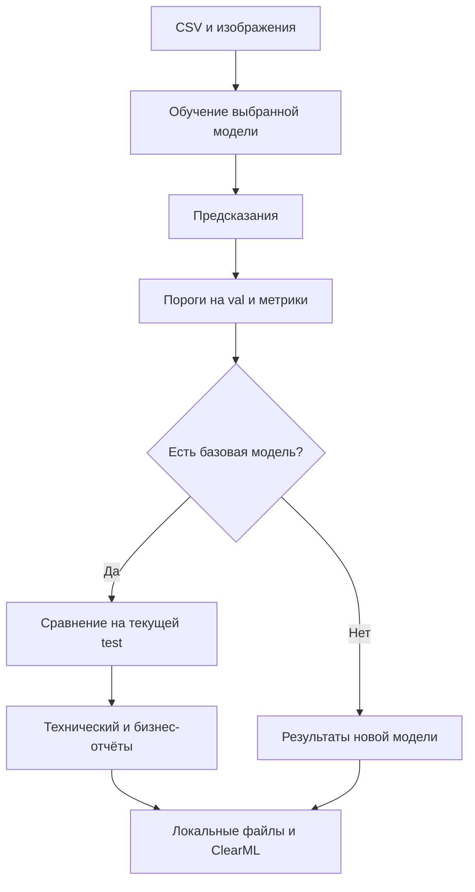

# clearml-yolo

`clearml-yolo` обучает модели детекции по CSV с разметкой, сохраняет лучшие веса
и результаты эксперимента в ClearML. Можно запустить только обучение или весь
процесс: предсказания, подбор порогов, оценку, сравнение моделей и отчёты.

FCOS, оценка batch и multi-GPU для нативных семейств доступны начиная с 0.41.0.
Проверки на реальных GPU имеют ограничения: подтверждение оценки YOLO и физическая
проверка DDP пока не завершены; см. [проверки релиза](specs/006-batch-training/evidence/release.md).
Примеры конфигурации не заменяют проверку выполнения.

## Обучение одной командой

Нужны установленный пакет для Python `>=3.12.13,<3.14` (Python 3.12 начиная с 3.12.13
или Python 3.13), настроенный доступ к ClearML с хранилищем артефактов, изображения
и CSV с выборками `train` и `val`. Для нативных запусков сборка Python и ядро Linux
должны поддерживать pidfd; одного номера версии недостаточно. Зависимости всех
поддерживаемых моделей и ONNX-экспорта входят в обычную установку без extras;
очередь и её TUI устанавливаются отдельным пакетом `cy-queue`.
[Установка и внешние требования](TECH_DETAILS.md#setup) описаны отдельно.
Ниже выбран GPU `0`; для CPU замените соответствующий `device=0`
на `device=cpu`. Прямые команды начинают работу сразу и не ждут свободного GPU.

Замените пути на свои, а проект, имя задачи и теги — на обозначения эксперимента.
Каждая строка запускает самостоятельное обучение, без предварительного создания YAML.

**YOLO:**

```bash
cy-train ground_truth=./ground_truth.csv ultralytics.model=yolo11n.pt ultralytics.device=0 clearml.project_name=detection clearml.task_name=yolo11n-train 'clearml.tags=[yolo,training]'
```

**DEIMv2:** при выполнении автоматически подготавливаются исходники утверждённой
ревизии и соответствующие веса backbone. Для закрытой сети доступны
[прокси и ручное размещение файлов](docs/model-assets.md).

```bash
cy-train model=deimv2/s ground_truth=./ground_truth.csv model.train.device=0 clearml.project_name=detection clearml.task_name=deimv2-s-train 'clearml.tags=[deimv2,training]'
```

**RF-DETR:**

```bash
cy-train model=rfdetr/small ground_truth=./ground_truth.csv model.train.device=0 clearml.project_name=detection clearml.task_name=rfdetr-small-train 'clearml.tags=[rfdetr,training]'
```

**Faster R-CNN:**

```bash
cy-train model=fasterrcnn/resnet50_fpn ground_truth=./ground_truth.csv model.train.device=0 clearml.project_name=detection clearml.task_name=fasterrcnn-train 'clearml.tags=[fasterrcnn,training]'
```

**FCOS** (начиная с 0.41.0):

```bash
cy-train model=fcos/resnet50_fpn ground_truth=./ground_truth.csv model.train.device=0 clearml.project_name=detection clearml.task_name=fcos-train 'clearml.tags=[fcos,training]'
```

После обучения откройте указанную задачу в проекте ClearML `detection`: ход обучения
находится в `Console`, `Scalars` и `Plots`, лучший чекпойнт — в `Output Models`.
Локальные файлы по умолчанию находятся в `runs/<проект>/<задача>-<task-id>/`;
точный путь к весам смотрите в журнале. Для YOLO это `best.pt`, у других семейств
имя и расширение определяет нативный backend.

## Повседневное обучение

### Источник разметки

`ground_truth` принимает локальный CSV или ссылку на финализированный ClearML Dataset.
Для набора по ID либо проекту и имени используйте:

```bash
cy-train 'ground_truth={dataset_id:DATASET_ID}' ultralytics.model=yolo11n.pt ultralytics.device=0 clearml.project_name=detection clearml.task_name=dataset-train 'clearml.tags=[training]'
cy-train 'ground_truth={project_name:annotations,name:ground-truth,version:"1.2.0"}' ultralytics.model=yolo11n.pt ultralytics.device=0 clearml.project_name=detection clearml.task_name=versioned-train 'clearml.tags=[training]'
```

Замените `DATASET_ID`, проект, имя и версию набора своими значениями.
В паре `project_name`/`name` можно опустить `version`: версию выберет ClearML SDK.
Указанный здесь проект относится к набору данных; `clearml.project_name` по-прежнему
задаёт проект эксперимента. ID нельзя совмещать с проектом, именем или версией.
Пустые, неизвестные и неполные поля вызывают ошибку.

Набор должен содержать только корневой `dataset.csv`: дополнительные файлы и ссылки
вызывают ошибку до загрузки. Входной CSV сохраняется без изменения байтов, изображения
остаются внешними, пути не переписываются. Абсолютные пути остаются абсолютными,
относительные считаются от каталога загруженного CSV. Используйте ссылки на изображения,
доступные выполняющему процессу. Особенности передачи архивов и кэша SDK описаны
в [контракте источников](docs/input-provenance.md#ground-truth-sources).

Этот ввод поддерживают `cy`, `cy-train`, `cy-predict`, `cy-val`, `cy-metrics`,
`cy-compare` и необязательный `ground_truth` в `cy-export`.
Локальный `ground_truth=./ground_truth.csv` продолжает работать: при выполнении
один раз выводится рекомендация использовать ClearML Dataset. Вложенные этапы
не повторяют предупреждение или загрузку. Справка, просмотр конфигурации и постановка
в очередь не скачивают набор; он разрешается при выполнении. Конфигурация для
повторного запуска сохраняет исходную ссылку, а фактические ID, версия и хеш CSV
записываются отдельно. Без явной версии новый запуск может выбрать другую версию.

### CSV и выборки

Локальный или загруженный CSV содержит абсолютные координаты углов рамки в пикселях:

```csv
image_name,image_path,instance_label,bbox_x_tl,bbox_y_tl,bbox_x_br,bbox_y_br,split
train.jpg,images/train.jpg,helmet,10,20,100,120,train
val.jpg,images/val.jpg,helmet,10,20,100,120,val
test.jpg,images/test.jpg,helmet,10,20,100,120,test
```

Это пример разметки существующих изображений. Одна строка описывает один объект;
для нескольких объектов повторите изображение. Для изображения без объектов
оставьте класс и координаты пустыми, не смешивая такую строку с рамками этого изображения.
`image_name` должен совпадать с именем файла. Пути к изображениям считаются от
каталога CSV, а путь самого CSV — от каталога запуска команды.

Строковые классы `NA`, `NULL`, `nan`, `None`, числовые строки и Unicode сохраняются
буквально; пустая ячейка остаётся признаком фона. Это правило действует также при
чтении кэша и публикации результатов. Относительные пути берутся из каталога CSV
и при отдельном предсказании, сравнении или `skip_train=true`, включая смену каталога Hydra.
Для оценки и сравнения требуется `image_name=name`; `stem` и `path` допустимы только
для экспорта сырых предсказаний. Неизвестные имена изображений вызывают ошибку до оценки.
Подробности и схема происхождения данных — в [контракте входов](docs/input-provenance.md).

`cy-train` требует непустые `train` и `val`; **полный `cy` по умолчанию требует ещё
и `test`**. Разбиение задаёте вы: команды обучения его не создают. Классы и состав
набора берутся из CSV, данные YOLO или COCO готовятся автоматически. Некорректные
рамки отбрасываются с сообщением; отсутствие допустимых обучающих рамок — ошибка.
Подробности — [контракт входных данных](specs/000-baseline/spec.md#detection-inputs-dataset-cache-and-output-routing).

### Модель и параметры

| Семейство | Все поддерживаемые значения `model=` |
| --- | --- |
| YOLO | `ultralytics` (по умолчанию); веса или архитектура задаются через `ultralytics.model` |
| DEIMv2 | `deimv2/s`, `deimv2/m`, `deimv2/l`, `deimv2/x` |
| RF-DETR | `rfdetr/nano`, `rfdetr/small`, `rfdetr/medium`, `rfdetr/large` |
| Faster R-CNN + ResNet FPN | `fasterrcnn/resnet50_fpn`, `fasterrcnn/resnet101_fpn` |
| Faster R-CNN + ConvNeXt/Swin | `fasterrcnn/convnext_tiny`, `fasterrcnn/swin_tiny` |
| Faster R-CNN + DINO | `fasterrcnn/dinov2_small`, `fasterrcnn/dinov3_small` |
| FCOS + ResNet FPN | `fcos/resnet50_fpn`, `fcos/resnet101_fpn` |
| FCOS + ConvNeXt/Swin | `fcos/convnext_tiny`, `fcos/swin_tiny` |
| FCOS + DINO | `fcos/dinov2_small`, `fcos/dinov3_small` |

Добавляйте параметры к выбранной команде обучения:

| Что изменить | YOLO | DEIMv2, RF-DETR, Faster R-CNN, FCOS |
| --- | --- | --- |
| Число эпох | `ultralytics.epochs=50` | `model.train.epochs=50` |
| Размер пакета | `ultralytics.batch=8` | `model.train.batch=8` |
| Размер изображения | `ultralytics.imgsz=640` | `model.train.imgsz=640` |
| Устройство | `ultralytics.device=0` | `model.train.device=0` |
| Начать обучение из весов | `ultralytics.model=./best.pt` | `model.train.weights=./best.pth` |

FCOS использует pretrained backbone и новую голову детектора, P3–P7 и размер 800
по умолчанию. Метки foreground начинаются с нуля; внутренний background Faster R-CNN
не меняется. Deployment-экспорт остаётся доступен только для Faster R-CNN.

Размер RF-DETR должен быть квадратным и кратным 32. Размеры по умолчанию и
ограничения backbone приведены в [руководстве по моделям](docs/multi-model-backends.md).
Для YOLO нужно явно задать `ultralytics.model`; у остальных семейств выбирается пресет.
По умолчанию запрашивается pretrained-инициализация. Недоступные или несовместимые
веса вызывают ошибку; скрытого перехода на другую модель или случайные веса нет.

Например, обучение YOLO с изменёнными параметрами:

```bash
cy-train ground_truth=./ground_truth.csv ultralytics.model=yolo11n.pt \
  ultralytics.epochs=50 ultralytics.batch=8 ultralytics.imgsz=640 ultralytics.device=0 \
  clearml.project_name=detection clearml.task_name=yolo11n-50ep 'clearml.tags=[yolo,experiment]'
```

Загрузка готовых весов начинает новое обучение; `resume` в CSV-режиме не поддерживается.
Нативные `data`, `classes`, `fraction` и `single_cls` не заменяют выборку из CSV.
Если переносите параметры из Ultralytics, используйте префикс `ultralytics.`;
[различия настроек и миграция](TECH_DETAILS.md#configuration-and-migration) описаны отдельно.

### Оценка batch перед обучением

В текущем исходном коде `cy-batch-estimate` измеряет batch на свободных CUDA GPU
локально, без задачи ClearML. По умолчанию проверяются 44 стандартных pretrained
варианта YOLO и все нативные пресеты. Для каждой модели, разрешения и профиля обучения
поиск выполняется на одном GPU каждого типа и объёма памяти; одинаковые GPU используют
общее измерение:

```bash
cy-batch-estimate --imgsz 960
cy-batch-estimate --imgsz 960 --models rfdetr/small,fcos/resnet50_fpn --devices 0,1
```

Синтетическая нагрузка по умолчанию — 150 классов и 300 объектов на изображение;
измените её через `--classes` и `--objects-per-image`. Бюджет памяти — 90% каждого GPU,
`--search-limit` задаёт предел поиска **на один GPU**, по умолчанию 1024 изображения.
Выбранный batch проверяется повторно в новом процессе; результат на пределе поиска
отмечается `ceiling_limited`. Если требуется новое измерение, используется первый
свободный GPU соответствующего типа среди `--devices`; остальные могут быть заняты.
Чужие процессы не останавливаются, помехи на измеряемом GPU приводят к ошибке.

`--gpu-counts` фильтрует только вывод: каждое N означает первые N GPU в порядке
`--devices`. Дополнительных поисков и распределённых проверок нет. Для одинаковых GPU
глобальный batch равен N × измеренный batch на GPU; для разных — N × наименьшая
совместимая ёмкость на GPU. Для каждого типа и объёма памяти нужно своё измерение.
Такие результаты помечаются `extrapolated`: это экстраполяция, а не измеренный
максимум для нескольких GPU. Глобальный batch может превышать `--search-limit`,
а статус предела исходных измерений сохраняется. Ошибки и прерванные проверки
сохраняются отдельно и не становятся рекомендациями.

Результаты сохраняются в `CY_HOME/.config/clearml-yolo/batch-estimates.json`.
Числовые значения по умолчанию не меняются. Только явный null включает строгий поиск:

```bash
cy-train ground_truth=./ground_truth.csv ultralytics.model=yolo11n.pt \
  ultralytics.imgsz=960 ultralytics.device=0 ultralytics.batch=null \
  clearml.project_name=detection clearml.task_name=yolo-estimated 'clearml.tags=[training]'

cy-train model=fcos/resnet50_fpn ground_truth=./ground_truth.csv \
  model.train.imgsz=960 model.train.device=0 model.train.batch=null \
  clearml.project_name=detection clearml.task_name=fcos-estimated 'clearml.tags=[training]'
```

Состав GPU, параметры обучения, число классов и максимальная плотность объектов
в `train`/`val` должны соответствовать сохранённым измерениям. Сначала выбирается
совместимое измерение для точного состава GPU, включая старые записи; иначе
рекомендация вычисляется из совместимых измерений на одном GPU. При несовпадении
запуск останавливается с инструкцией. Исходный null остаётся в replay, а выбранный
batch, происхождение, состав GPU и ключи/статусы исходных измерений записываются
отдельно. Очередь сохраняет null, а worker разрешает его на выделенных GPU.
OOM при обучении не вызывает автоматический повтор или скрытое уменьшение batch. Пользовательский Albumentations JSON
требует явного batch. Значение batch — глобальный микробатч по всем GPU, кратный их
числу; накопление градиентов отдельно определяет размер шага оптимизатора.
Подробности поиска, совместимости и ограничений — в [руководстве](docs/batch-estimation.md).

### Свои аугментации и Mosaic

Для всех моделей `cy-train` и `cy` принимают JSON, сохранённый через
`albumentations.save`. Например:

```python
from pathlib import Path

import albumentations as A

pipeline = A.Compose(
    [A.HorizontalFlip(p=0.5), A.RandomBrightnessContrast(p=0.2)],
    bbox_params=A.BboxParams(format="pascal_voc", label_fields=["class_labels"]),
)
A.save(pipeline, Path("augmentation.json"))
```

```bash
cy-train model=rfdetr/nano ground_truth=./ground_truth.csv \
  transforms=albumentations transforms.pipeline_file=./augmentation.json \
  model.train.device=0 model.train.epochs=20 \
  clearml.project_name=detection clearml.task_name=rfdetr-custom \
  'clearml.tags=[rfdetr,custom-augmentation]'
```

`transforms=default` сохраняет нативный рецепт. В режиме `albumentations` отключаются
встроенные случайные аугментации выбранной модели, включая нативный Mosaic;
конфликтующие параметры заменяются с сообщением в журнале. Обязательные resize,
подготовка тензоров и нормализация остаются у backend. Поэтому не добавляйте
`Normalize`, `ToFloat` или `ToTensorV2` в JSON. Свой `Resize` допустим, но окончательный
размер модели по-прежнему задаётся через `ultralytics.imgsz` или `model.train.imgsz`.

Для Mosaic поставьте один `A.Mosaic(...)` первым в корневом `A.Compose`.
Дополнительные изображения из обучающей выборки подбираются автоматически для всех
семейств. Готовые примеры — [flip.json](examples/augmentation/flip.json) и
[mosaic.json](examples/augmentation/mosaic.json). JSON проверяется до обучения;
его содержимое и хеш сохраняются для повторного запуска без исходного файла.
Порядок операций, ограничения, экспорт конфигурации и правила конфликтов описаны
в [руководстве по аугментациям](docs/augmentation.md).

## Полный эксперимент

`cy` связывает обучение с предсказаниями, калибровкой порогов на `val` и оценкой
через `digital-metrics`. При наличии базовой модели он сравнивает её с новой
на текущей выборке `test` и создаёт отчёты через `report-generator`.

```bash
cy ground_truth=./ground_truth.csv ultralytics.model=yolo11n.pt \
  ultralytics.epochs=50 ultralytics.device=0 ultralytics_predict.device=0 \
  run_dir=./runs/experiment-01 clearml.project_name=detection \
  clearml.task_name=yolo11n-experiment 'clearml.tags=[yolo,experiment]'
```

Для другого семейства выберите `model=...` и используйте `model.train.*` /
`model.predict.*`, как в обучении. Устройство обучения и предсказаний задаётся отдельно.



По умолчанию базовая модель берётся из последней завершённой задачи с тегом `prod`
в том же проекте ClearML, исключая текущую задачу. Если такой задачи нет, остаются
предсказания, метрики и графики новой модели; сравнение и парные отчёты пропускаются.
Для явного выбора добавьте `compare.baseline_model.task_id=BASELINE_TASK_ID`.
Ошибка загрузки явно выбранной модели завершает команду с ошибкой.

В новом эксперименте старая модель заново предсказывает на текущих `test`-изображениях.
Метрики обеих моделей считаются по одной актуальной разметке и согласованным
настройкам предсказаний. Сохранённые веса и пороги базовой модели остаются прежними;
новые пороги подбираются только на `val`. При повторе в том же каталоге с теми же
входами и настройками предсказания могут браться из кэша, метрики пересчитываются.

| Результат | Где искать |
| --- | --- |
| Настройки, журнал и ход обучения | `Configuration`, `Console`, `Scalars`, `Plots` одной задачи ClearML |
| Лучшие веса | `Output Models`; локальный путь указан в журнале |
| Разметка и предсказания | Артефакты `gt_csv` и `predicts_csv` |
| Пороги, метрики и графики | Артефакты порогов, книги метрик и `Plots` |
| Парное сравнение и отчёты | XLSX после успешного сравнения с базовой моделью |
| Файлы запуска | `run_dir` либо `runs/<проект>/<задача>-<task-id>/` |

Используйте новый каталог для нового эксперимента. `CY_HOME` задаёт рабочий корень
(по умолчанию каталог запуска); выходы, кэш и журналы должны оставаться внутри него.
Входные данные могут находиться снаружи. Сбой обязательной загрузки в ClearML
завершает запуск с ошибкой, сохраняя локальные результаты.

Параметры ClearML `General` содержат настройки эксперимента без нативных
`device`, `project`, `name`, `save_dir`, `exist_ok` и сгенерированного пути `data`.
При запуске через CLI полная очищенная от секретов конфигурация остаётся
в `Configuration / run`, включая реальное значение `device`, и используется
для повторного запуска.
В `run` видны только активные настройки выбранного backend. Отдельный JSON
`Configuration / run_overrides` показывает отличия от встроенных настроек той же команды
и выбранного пресета модели, включая YAML и CLI. Служебные пути и результаты туда не входят;
для клонирования используется `run`. `General` появляется до подготовки датасета,
затем уточняется нативными callback; при пропуске обучения эти параметры не создаются.

Готовые артефакты появляются по ходу запуска: `gt_csv` — после подготовки разметки,
пороги — после калибровки, книги метрик — после оценки каждого split.
Общий `predicts_csv` загружается один раз, когда все включённые этапы закончили
добавлять и обогащать строки, до последующих отчётов. Каждая окончательная книга
и файл экспорта публикуются после завершения записи. При более позднем сбое готовые
артефакты остаются доступны; неполный общий CSV остаётся локальным. Успех задачи
по-прежнему требует проверки обязательных загрузок и финального flush.

Клоны старых задач могут сохранять прежние ключи `General`: новая публикация
не удаляет унаследованные параметры.

Для кэширования шагов внешнего ClearML Pipeline Controller нужно явно подключить
`normalize_task_hash` до создания кэшируемых заданий; пример есть в
[техническом руководстве](TECH_DETAILS.md#clearml-pipeline-cache-identity).
При поддерживаемом нативном обучении YOLO `[0,1]` и `[2,3]` эквивалентны как два
CUDA-устройства; число и тип устройств,
научные настройки и входные данные по-прежнему различают эксперименты. Попадание
в кэш возвращает прежнюю задачу с её артефактами и моделями, не создавая файлы
в новом локальном каталоге.

## Отдельные рабочие процессы

Каждая команда ниже создаёт свою задачу ClearML. Замените пути и идентификаторы
на реальные. Примеры с локальным `best.pt` предполагают YOLO-чекпойнт.

### Предсказания — `cy-predict`

Нужны веса и CSV, задающий изображения. Команда сохраняет таблицу рамок, классов
и уверенности; параметр `splits` ограничивает выборки.

```bash
cy-predict weights=./best.pt ground_truth=./ground_truth.csv 'splits=[val,test]' \
  model_label=local-yolo ultralytics_predict.device=0 output=./predictions/predictions.csv \
  clearml.project_name=detection clearml.task_name=yolo-predict 'clearml.tags=[prediction]'
```

Результат — указанный CSV, файл происхождения рядом с ним и артефакт `predicts_csv`.
Для нового семейства укажите его `model=...` и `model.predict.device=0` вместо
`ultralytics_predict.device=0`. DEIMv2 использует явно заданный `model.source_dir`
или подготавливает исходники утверждённой ревизии автоматически.

### Проверка модели — `cy-val`

Нужны готовые веса, разметка и `val` для подбора порогов. Команда получает
предсказания, фиксирует пороги на `val` и оценивает выбранные выборки.

```bash
cy-val weights=./best.pt ground_truth=./ground_truth.csv 'splits=[val,test]' \
  model_label=local-yolo ultralytics_predict.device=0 output_dir=./validation \
  clearml.project_name=detection clearml.task_name=yolo-val 'clearml.tags=[validation]'
```

В `output_dir` сохраняются предсказания, пороги, книги метрик и графики; результаты
публикуются в ClearML. `val` используется для калибровки даже при оценке только `test`.

### Метрики по таблицам — `cy-metrics`

Нужны CSV разметки и предсказаний для `val` и оцениваемых выборок. Обучение и
инференс не запускаются. Пороги подбираются на `val` (`calibration_split=val`)
и затем применяются к остальным выборкам.

```bash
cy-metrics ground_truth=./ground_truth.csv predictions=./predictions/predictions.csv \
  'splits=[val,test]' model_label=local-yolo output_dir=./metrics \
  clearml.project_name=detection clearml.task_name=yolo-metrics 'clearml.tags=[metrics]'
```

Результат — пороги, книги метрик и графики в `output_dir` и ClearML. Команда не
создаёт и не изменяет зарегистрированную модель. Формат таблиц и правила оценки —
в [техническом справочнике](TECH_DETAILS.md#inputs-and-evaluation).

### Сравнение двух моделей — `cy-compare`

Нужны текущая разметка и две ссылки на модели с сохранёнными порогами. По умолчанию
сравнение идёт на `test`. В примере веса и пороги восстанавливаются из задач ClearML:

```bash
cy-compare ground_truth=./ground_truth.csv baseline_model.task_id=BASELINE_TASK_ID \
  candidate_model.task_id=CANDIDATE_TASK_ID ultralytics_predict.device=0 \
  output_dir=./comparison clearml.project_name=detection \
  clearml.task_name=paired-comparison 'clearml.tags=[comparison]'
```

Обе модели получают одни и те же текущие изображения; исторические метрики не
подменяют новую оценку. Результат — парные книги метрик, таблицы сравнения и
`comparison_manifest.json` в `output_dir`, необходимые следующему шагу.

Для локальных весов задайте у каждой ссылки `source=local`, `weights`, `label`
при неизвестном происхождении и `thresholds` с точными порогами всех классов.
Берите пороги из калибровки этой модели, не придумывайте общий порог.
Модели могут принадлежать разным семействам. Для внешних нативных весов без метаданных
нужны также backend, пресет, упорядоченные классы и preprocessing; см.
[правила ModelRef](docs/multi-model-backends.md#data-checkpoints-and-comparison).

### Отчёты — `cy-report`

Нужен каталог `cy-compare` с манифестом и обеими оценёнными книгами, а не произвольные
метрики прежних экспериментов.

```bash
cy-report comparison_dir=./comparison output_dir=./reports \
  clearml.project_name=detection clearml.task_name=paired-reports 'clearml.tags=[reports]'
```

Команда создаёт технический и бизнес-отчёты XLSX в `output_dir` и публикует их в ClearML.
Для старого манифеста без идентичности моделей задайте `baseline_label=baseline`
и `candidate_label=candidate`. Свои настройки отчёта передавайте через `report_config_path`.

### Локальные веса и происхождение результатов

Если у весов или CSV нет сведений об исходной модели, `cy-predict`, `cy-val`,
`cy-metrics` и `cy skip_train=true` требуют понятный `model_label`. В сравнении
используются `baseline_model.label` и `candidate_model.label`. Подпись не регистрирует
модель в ClearML: ID обучения будет отмечен как недоступный. Сохранённое происхождение
имеет приоритет над введённой подписью.

Переносите веса вместе с `<checkpoint>.identity.json`, а предсказания — с
`<predictions.csv>.provenance.json`. Устаревшие или противоречащие содержимому сведения
вызывают ошибку. Не редактируйте и не пересохраняйте подписанные книги метрик для
повторного использования: пересоздайте их из исходных данных.
[Подробности о происхождении и публикации](TECH_DETAILS.md#provenance-and-publication).

## Воспроизводимые эксперименты

Запускайте команды экспериментов из рабочего дерева Git, чтобы сохранять историю
конфигурации. `cy`, `cy-train`, `cy-predict`, `cy-val`, `cy-metrics`, `cy-report`,
`cy-compare`, `cy-export` и `cy-ground-truth` один раз предупреждают в stderr, если
не удаётся подтвердить, что каталог запуска находится под управлением Git.
Проверка действует и для `--help` / `--cfg job`, не прерывает команду и не меняет stdout.
Можно перейти в существующий репозиторий или осознанно выполнить `git init`;
сами команды репозиторий не создают. Проверяется исходный каталог запуска,
независимо от `CY_HOME`; вложенные каталоги, worktree, submodule и репозитории
без коммитов поддерживаются. При отсутствии Git или ошибке проверки предупреждение
означает, что принадлежность рабочему дереву не удалось проверить.

### YAML и переопределения

Когда параметры повторяются, сохраните их в конфигурации:

```bash
cy-init-config cy-config
```

По умолчанию создаются `cy.yaml`, `ultralytics/default.yaml` и
`ultralytics_predict/default.yaml`. В `cy-config/cy.yaml` измените поля, сохранив
остальные настройки и список `defaults`:

```yaml
ground_truth: ./ground_truth.csv
clearml:
  project_name: detection
  task_name: yolo11n-configured
  tags: [configured, experiment]
```

В `cy-config/ultralytics/default.yaml` измените нативные ключи без обёртки `ultralytics:`:

```yaml
model: yolo11n.pt
epochs: 50
imgsz: 640
batch: 8
device: 0
```

В `cy-config/ultralytics_predict/default.yaml` задайте параметры предсказаний:

```yaml
batch: 4
conf: 0.001
iou: 0.7
device: 0
```

`data`, `source` и маршрутизацией файлов pipeline управляет `cy`. Параметры `conf`
и `iou` здесь относятся к предсказаниям, а не к порогам итоговой оценки.

```bash
cy --config-dir cy-config --config-name cy
cy --config-dir cy-config --config-name cy ultralytics.epochs=20
```

Первый запуск использует YAML, второй переопределяет число эпох. Проверить составленную
конфигурацию без обучения можно добавлением `--cfg job --resolve`.

Для отдельной команды и другого семейства:

```bash
cy-init-config train-config --command cy-train --model rfdetr/small
```

Свежий экспорт включает локальную базу: `pipeline.yaml` для `cy`, `train.yaml` для
`cy-train`, выбранную модель, оба профиля аугментаций и все YAML из их `defaults`.
Ранее `pipeline` мог разрешаться из встроенного ConfigStore без файла в каталоге.
Публичные имена YAML теперь отделены от имён схем; старые деревья продолжают работать
без автоматической перезаписи. Интерполяция, приоритет локальных файлов и CLI сохраняются.

Редактируйте `train-config/cy-train.yaml` и `train-config/model/rfdetr/small.yaml`,
затем запускайте `cy-train --config-dir train-config --config-name cy-train`.
`--command` поддерживает `cy`, `cy-train`, `cy-predict`, `cy-val`, `cy-metrics`,
`cy-compare`, `cy-report`, `cy-ground-truth`, `cy-export`. Команды работы с таблицами
создают обёртку и локальную базу; `cy-export` по умолчанию выбирает Faster R-CNN.
Существующие выбранные файлы вызывают ошибку; `--force` заменяет их, сохраняя файлы
других команд. Перед обновлением сохраните свои настройки; см.
[миграцию конфигураций](TECH_DETAILS.md#configuration-and-migration).

### Перебор параметров и DDP

Hydra запускает перебор с `-m`. Прямой запуск выполняет варианты последовательно:

```bash
cy --config-dir cy-config --config-name cy -m ultralytics.epochs=10,20
```

Все задачи одного перебора получают общий читаемый тег с датой и временем UTC
и случайной фразой из слов дополнительно
к вашим тегам. Это работает и для отдельных стадий, и для очереди; одиночный запуск
без multirun такого тега не получает.

Для нативного DDP в YOLO задайте несколько устройств обучения и одно для предсказаний:

```bash
cy --config-dir cy-config --config-name cy 'ultralytics.device=[0,1]' ultralytics_predict.device=0
```

В текущем исходном коде DEIMv2, RF-DETR, Faster R-CNN и FCOS принимают несколько
устройств обучения через `'model.train.device=[0,1]'`. Глобальный `model.train.batch`
должен делиться на число GPU. Внешний процесс владеет единственной задачей ClearML,
rank zero — чекпойнтами и агрегированными метриками. Предсказания используют один GPU,
а очередь после обучения сохраняет первый выделенный GPU. Реальная multi-GPU
приёмка остаётся открытой; [руководство DDP](docs/ddp-testing.md) описывает проверки.

## Подготовка весов для работы без сети

Проверьте наличие команды в установленной версии и выполните:

```bash
cy-download-weights
```

Команда подготавливает каталог детекторных YOLO, RF-DETR, подходящих backbone
Faster R-CNN/FCOS и DEIMv2 small/medium с закреплёнными исходниками. DEIMv2 large/xlarge
и `dinov3_small` исключены из массовой подготовки; их явный выбор работает по прежним
правилам. Веса размещаются в штатных кэшах библиотек, DEIM — под `CY_HOME`.
Настройки SDK не переписываются. Код возврата ненулевой, если подготовка неполная;
повторный запуск повторяет недостающие загрузки и использует проверенные файлы.

При реальном выполнении `cy` каталог подготавливается автоматически один раз для
сочетания каталога и расположений кэшей. Частичные ошибки тоже завершают попытку:
они дают предупреждение, после чего продолжается обычное выполнение выбранной модели.
Для повторной попытки используйте команду выше. Прерывание оставляет попытку
незавершённой. Справка, просмотр конфигурации, отправка в очередь и отдельные стадии
вроде `cy-train` массовую подготовку не запускают.

Пользовательский YAML архитектуры, `pretrained`, пути, `resume` и Hydra-переопределения
сохраняют смысл; имя YAML не подменяет архитектуру весами. Любое значение
`ultralytics.cfg`, кроме `null`, по-прежнему не поддерживается. Для Hugging Face доступны
`HF_ENDPOINT` и штатная авторизация через `HF_TOKEN`; не включайте токены в отчёты.
[Каталог, прокси, штатные кэши и восстановление](docs/model-assets.md) описаны отдельно.

## Выполнение через ClearML Agent

Внешний ClearML Agent запускает сохранённую точку входа без повторения исходных
аргументов CLI. CY читает конфигурацию `run` до проверки обязательных входов
и выбора backend, затем присоединяется к той же задаче ClearML. Отсутствующий
`run` допускает полный явный набор аргументов; пустой или некорректный `run`
вызывает ошибку. Устройства выбираются в логическом пространстве, заданном
Agent через `CUDA_VISIBLE_DEVICES`; очередь CY в этом запуске не участвует.

Зависимости устанавливает ваше окружение Agent. Для DEIMv2, RF-DETR, Faster R-CNN и FCOS
CY разрешает модельные файлы только при выполнении: сначала проверяет локальные
файлы и кэш, затем настроенный прокси и исходный URL. `GHR` задаёт корень прокси
GitHub Releases, `GH` — корень VCS-репозитория Artifactory для архива DEIMv2.
При ошибке скачивания разместите перечисленные файлы по точным путям из сообщения
и повторите запуск; предыдущая онлайн-загрузка не нужна. Явно заданные пути
не заменяются автоматическими. Исходные значения, включая `null`, сохраняются
для replay, а разрешённые пути, URL и хеши записываются в отдельный Configuration Object
`model_assets`. Подробности —
[запуск Agent](docs/runtime-isolation.md#clearml-agent-execution)
и [модельные файлы](docs/model-assets.md).

## Выполнение через очередь

Прямые `cy` и `cy-train` используют нативные устройства без ожидания и резервирования.
`cy-queue` — отдельный пакет с пространством имён `cy_queue`, который зависит от
совместимой версии CY. Он сохраняет задания, ждёт доступный полный набор GPU
и запускает работу через worker владельца. Прямые команды и ClearML Agent
не требуют этого пакета или настроек очереди. Старые `queue.*`, `autogpu.*`
и Hydra launcher удалены.

Сначала установите CY из исходников по [инструкции](docs/development.md#external-dependencies),
затем очередь из отдельного [публичного репозитория](https://github.com/BuckanovNikita/cy-queue)
в то же окружение. Публикация пакетов в PyPI
не предполагается. Из каталога `clearml-yolo`:

```bash
# Клонирование требуется только при отсутствии соседнего checkout:
git clone https://github.com/BuckanovNikita/cy-queue.git ../cy-queue
uv sync --frozen --inexact
uv pip install --python .venv/bin/python -e . -e ../cy-queue
uv pip check --python .venv/bin/python
uv run --frozen --no-sync cy-queue --help
```

Установка обоих исходников одной командой проверяет совместимость версий и обновляет
метаданные editable-установок. Диапазон поддерживаемых версий CY задаёт пакет очереди.

Перед синхронным обновлением всех участников остановите отправку и workers,
дождитесь завершения активных заданий и выполните необходимое восстановление.
Сохраните старые записи, настройки и каталоги координации. После изменения
окружения ожидающие задания нужно отправить заново; подробнее —
[порядок обновления](docs/queue.md#coordinated-package-upgrade).

Каждый пользователь должен создать и заполнить
`~/.config/clearml-yolo/queue.toml`. Если задан абсолютный `XDG_CONFIG_HOME`, файл
читается из `$XDG_CONFIG_HOME/clearml-yolo/queue.toml`. Все три поля обязательны;
пользователи общей очереди указывают одинаковые каталоги:

```toml
[queue]
name = "Обучение команды"
root = "/srv/clearml-yolo/queue"
coordination_root = "/var/lib/clearml-yolo/coordination"
```

Все пути должны быть абсолютными. `root` может находиться на NFS.
`coordination_root` допускает локальную Linux-файловую систему либо NFS/NFSv4 с
действующими параметрами `hard,local_lock=flock` (или `local_lock=all`) и общим кэшем;
`soft`, `softerr`, `nosharecache` не поддерживаются. Все участники одного хоста
используют общий NFS-клиент, кэш inode и пространства монтирования/PID.
Администратор настраивает доступ к общим каталогам. При недоступности hard NFS
операции с файлами могут ждать без ограничения времени; подробнее —
[условия NFS-координации](docs/queue.md#nfs-coordination).

```bash
cy-queue config
```

Можно явно выбрать общий файл вместо пользовательского:

```bash
export CY_QUEUE_CONFIG=/etc/clearml-yolo/queue.toml
cy-queue config
```

Экспорт в одном терминале не меняет окружение других пользователей и сервисов worker.
Без заполненного файла команды очереди завершаются с объяснением; файл и каталоги
автоматически не создаются. `cy-queue config --json` показывает настройки без создания
очереди. При обновлении укажите существующие каталоги: перенос не выполняется
автоматически, а конфликт координации останавливает запуск для сохранения данных
восстановления. Разрешение NFS не отменяет эту проверку.

Для отправки конфигурации из примера выше сначала удалите значения GPU из обоих
YAML (`device: null` вместо `device: 0`). Очередь назначит весь выделенный набор
обучению и первое устройство предсказаниям; явно выбранные CPU-этапы сохраняются.
После возврата из обучения и освобождения неиспользуемой памяти guardian подтверждает
сокращение резерва до первой GPU. Остальные GPU становятся доступны другим заданиям
во время предсказаний с учётом обычной проверки занятой памяти. Без явного освобождения первая GPU остаётся
зарезервированной до завершения pipeline и его дочерних процессов. Если уведомление
о завершении обучения не отправлено, сохраняется весь резерв. После сохранённого
сокращения резерва ошибка записи состояния или потеря подтверждения не возвращает
освобождённые GPU. Pipeline останавливается до предсказаний; очистка и восстановление
используют оставшийся сохранённый резерв. Такой запуск не считается успешным.

Очисткой дочерних процессов управляет внешний guardian. Если вычисления и обязательные
загрузки завершены успешно, поздняя неопределённость очистки не меняет успешный статус
ClearML: очередь показывает `recovery_required` и сохраняет карантин ресурсов.
Наличие артефактов само по себе не подтверждает ни успех всех загрузок, ни безопасное
освобождение GPU; [восстановление](docs/queue.md#guardians-cancellation-and-recovery)
по-прежнему требует доказательства владения процессами.

```bash
cy-queue submit --gpus 1 -- --config-dir cy-config --config-name cy
cy-queue submit --command train --gpus 1 -- --config-dir train-config --config-name cy-train
cy-queue worker
```

`submit` по умолчанию запускает pipeline (`cy`); `--command train` запускает
`cy-train`. Для второго примера сначала подготовьте конфигурацию
`cy-init-config train-config --command cy-train` и заполните её входы.
Явные CPU-этапы сохраняются, но каждое задание очереди требует хотя бы одну GPU;
`--gpus 0` не поддерживается.

По умолчанию worker пишет в stderr сообщения INFO о запуске, изменениях заданий,
выделенных GPU и причинах ожидания, а также сводку каждые 60 секунд.
`cy-queue worker --log-level DEBUG` добавляет сводку каждого опроса;
`--log-level WARNING` убирает обычные сообщения. Читаемые результаты команд и
явно запрошенный JSON выводятся в stdout.
Логи pipeline сохраняются в `.cy/queue-logs/JOB_ID.log` внутри проекта отправки;
подробнее — [диагностика worker](docs/queue.md#worker-diagnostics).

`submit` возвращает номер и имя, например `Job 17 · Обучение детектора`.
Команды принимают `job-17`; номер сохраняется при перестановке и архивации.
Имя берётся из настроенного имени задачи ClearML; его можно изменить через
`submit --label "Обучение детектора"`. Для скриптов добавьте `--json`:
машинные идентификаторы сохранены, а старые идентификаторы принимаются на входе.
Worker запускайте в отдельном терминале или как отдельный
процесс своего Unix-пользователя. После отправки терминал submit можно закрыть.
Для выбора устройств вместо количества задайте `--devices 0,2`: это логические
CUDA-индексы с учётом `CUDA_VISIBLE_DEVICES`. Не совмещайте `--gpus` и `--devices`.

Состояние и отмена собственного задания:

```bash
cy-queue list
cy-queue cancel job-17
```

Завершённые, неудачные и отменённые задания можно скрыть из основного списка:

```bash
cy-queue archive job-17 job-18
cy-queue list --archived
cy-queue list --all --json
cy-queue restore job-17
```

Архивировать и восстанавливать может только владелец. Архив сохраняет результаты,
порядок, конфигурации и логи; возврат в список не запускает задание заново.
Задание с `recovery_required` всегда появляется в основном списке. При ошибке
хранилища часть группы может уже оказаться в архиве; повтор команды безопасен.

Перебор также отправляется целиком; все варианты проверяются до постановки в очередь:

```bash
cy-queue submit --gpus 1 -- -m --config-dir cy-config --config-name cy ultralytics.epochs=10,20
```

Терминальный интерфейс входит в обычную установку:

```bash
cy-queue tui
```

В TUI выбирайте задания стрелками. `b`/`a` переставляют задание перед или после
выбранного из списка ожидающего задания. `x` архивирует, `s` возвращает из архива,
`v` переключает основной список, архив и всю историю, `o` открывает задачу ClearML.

Закрытие TUI не останавливает worker. Очередь требует Linux с общей PID/lock-средой;
автоматически доступна GPU с занятой VRAM строго меньше 2 GiB (2048 MiB). Ровно 2 GiB
уже считается занятой памятью. Этот порог фиксирован и повторно проверяется перед
запуском каждого задания; список процессов и загрузка GPU не участвуют в проверке.
Текущие резервы очереди и явные блокировки исключают GPU, а устаревшие записи без
удерживаемой блокировки сами по себе не мешают новому запуску.

Команды оператора используют физические номера `nvidia-smi`, независимо от
`CUDA_VISIBLE_DEVICES`. В выводе очереди используются эти номера или метки из слов для
отсутствующих устройств; полные GPU UUID и токены резервов не показываются.

```bash
cy-queue gpu list
cy-queue gpu disable 2
cy-queue gpu enable 2
cy-queue gpu free 2
```

`gpu free 2` и равнозначная `gpu release 2` сразу снимают существующие резервы и
блокировки только GPU 2 во всех очередях хоста. Токены, причины, флаги force,
подтверждения и дополнительные проверки памяти или процессов не нужны. Команда
не посылает сигналы процессам и не меняет результат задания; резервы остальных GPU
сохраняются. Исходный каталог очереди может быть недоступен. Следующее задание всё
равно проходит новую проверку памяти перед запуском.

Настройка `CY_QUEUE_CONFIG`, совместимость `CY_QUEUE_ROOT`, перестановка заданий, восстановление после
сбоя и физические GPU-контролы описаны в [руководстве оператора](docs/queue.md).
Не удаляйте lock-файлы и резервы для разблокировки задания.

Сообщения, TUI, подписи отчётов и публикуемая консоль используют имена и читаемые
ссылки вместо UUID и хешей. Точные значения остаются в машинных метаданных,
явном JSON, исходных логах и адресах ссылок; см.
[правила отображения](docs/readable-output.md).

## Дополнительные возможности

### Экспорт Faster R-CNN — `cy-export`

Для CPU/FP32 ONNX нужен Faster R-CNN-чекпойнт; зависимости входят в обычную установку:

```bash
cy-export model=fasterrcnn/resnet50_fpn weights=./best.pth \
  export.operation=onnx export.device=cpu export.precision=fp32 output_dir=./exported \
  clearml.project_name=detection clearml.task_name=fasterrcnn-onnx 'clearml.tags=[export]'
```

Результат — ONNX и метаданные. Отдельные операции собирают TensorRT engine и проверяют
его на GPU; самостоятельный runner не требует Torch и не создаёт задачу ClearML.
Команды, профили и требования к проверке — в [руководстве TensorRT](docs/tensorrt-deployment.md).

### Конвертация YOLO-разметки — `cy-ground-truth`

Если готового CSV ещё нет, можно получить его из YOLO `data.yaml` и изображений:

```bash
cy-ground-truth data_yaml=./dataset/data.yaml output=./converted/ground_truth.csv \
  test_fraction=0.5 seed=0 clearml.project_name=detection \
  clearml.task_name=convert-ground-truth 'clearml.tags=[conversion]'
```

Результат — CSV с рамками в пикселях и назначенными выборками. Если в источнике нет
`test`, часть исходной `val` выделяется в `test` по `test_fraction` и `seed`;
проверьте получившееся разбиение до обучения. Подробнее —
[контракт конвертации](specs/000-baseline/spec.md#commands-and-configuration).

### FiftyOne

FiftyOne позволяет смотреть изображения, разметку и предсказания, находить пропуски
и ложные срабатывания. Для полной выборки панели показывают те же результаты
`digital-metrics`, что и `cy`. Окно просмотра открывается вручную по
[руководству FiftyOne](TECH_DETAILS.md#open-a-published-fiftyone-dataset).
Ошибка необязательной визуализации даёт предупреждение и не отменяет успешное вычисление.
Настройки процесса и таймаутов — в [техническом справочнике](TECH_DETAILS.md#fiftyone-and-process-ownership).

### Обслуживание кэша — `cy-dedup`

Остановите запись в выбранный кэш и сначала посмотрите кандидатов:

```bash
cy-dedup --dry-run
cy-dedup
```

По умолчанию проверяется `$CY_HOME/.cache`, либо `.cache` в каталоге запуска.
На поддерживающей reflink файловой системе Linux одинаковые изображения могут
разделять блоки данных, сохраняя независимость при записи. Пути и содержимое
сохраняются; ClearML и GPU не нужны. Подробности ограничений и dry-run —
в [правилах обслуживания кэша](TECH_DETAILS.md#filesystem-and-cache).

## Если запуск не удался

| Проблема | Что проверить |
| --- | --- |
| Нет изображений или выборки | Пути относительно CSV; `train`/`val` для обучения и `test` для полного процесса |
| Нет совместимой оценки batch | Повторите `cy-batch-estimate` на нужных свободных GPU с подходящей нагрузкой либо задайте числовой batch; см. [контракт](docs/batch-estimation.md) |
| Неизвестный параметр | Правильную группу; создайте свежий YAML через `cy-init-config` в новом каталоге |
| Не загружается модель | Семейство, пресет, совместимость весов и зависимости; [сообщение о недостающих файлах](docs/model-assets.md#offline-placement-and-access) содержит исходный URL, абсолютный путь и параметр для ручного размещения |
| Требуется подпись модели | Передайте `model_label` или подписи ModelRef; сохраните файлы происхождения |
| Очередь ждёт GPU | Наличие worker владельца, полного набора устройств, резервы и порог памяти; прямой запуск не ждёт |
| Нет парных отчётов | Наличие завершённой базовой задачи с тегом `prod` или корректной явной ссылки |
| Сбой ClearML или публикации | Доступ к сервису и хранилищу, локальный журнал; запуск с незавершённой обязательной публикацией считается ошибкой |

Для краткого журнала задайте `LOGURU_LEVEL=INFO`, для стека — `DEBUG` (по умолчанию),
для диагностики долгих операций — `TRACE`. При остановке нажмите `Ctrl+C` и дождитесь
очистки дочерних процессов. Диагностика не добавляет автоматических повторов.

Далее: [технический справочник](TECH_DETAILS.md), [каталог контрактов](docs/current-contracts.md),
[диагностика](docs/diagnostics.md), [разработка и релизы](docs/development.md).
