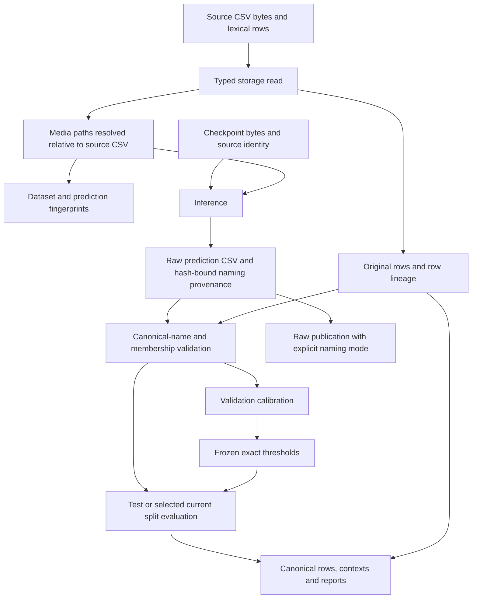

# Detection inputs and evaluation provenance

Storage owns detection-CSV interpretation and filesystem resolution. Core owns pure
identity validation; workflows consume typed storage ports. Generic CSV readers remain
separate from detection readers.

| Boundary | Input → output | Invariant and owner | Failure behavior / check |
| --- | --- | --- | --- |
| Detection CSV | CSV → lexical source rows and execution view | Literal `NA`, `NULL`, `nan`, `None`, numeric-looking and Unicode identities survive; empty background cells remain empty; row order and numeric precision survive reload | Storage rejects invalid required values; literal-label and round-trip regressions |
| Media resolution | CSV location and lexical image path → resolved execution path | Relative paths use the CSV directory, including Hydra cwd changes; original export rows retain lexical names | Missing/invalid media fails at its consuming boundary; conflicting-cwd regressions |
| Dataset cache | CSV digest, resolved image-reference identity, format, preparation version → entry | Different resolved images separate entries; identical absolute references may reuse; old entries remain | Hit avoids image-content hashing, mtime checks, copy and conversion; unchanged-path image edits require explicit invalidation |
| Prediction provenance | Prediction bytes and checkpoint identity → hash-bound naming mode | New sidecars record `prediction_image_name`; source row lineage remains intact | Hash conflicts fail; historical missing mode is accepted only with canonical membership |
| Evaluation | Canonical `image_name=name` predictions and selected current GT → metrics | `stem`/`path` are raw-export modes; unknown image identities cannot silently disappear | Reject incompatible mode or membership before scoring; canonical baseline parity tests |
| Publication | Raw/evaluated rows plus contexts → canonical artifacts | Raw media association uses explicit naming mode and never claims evaluation; evaluated rows preserve source IDs | Required uploads/flush fail the invocation; download/readback proves lexical identity and lineage |

Validation calibrates candidate thresholds; test and comparison consume frozen thresholds.
Historical source recovery follows the [ordered recovery contract](../specs/012-remove-legacy-compatibility/contracts/task-recovery.md),
and artifact/context ownership follows the [publication contract](../specs/014-evaluation-publication/contracts/publication.md).
Scientific algorithms and approved dependency revisions remain unchanged.
