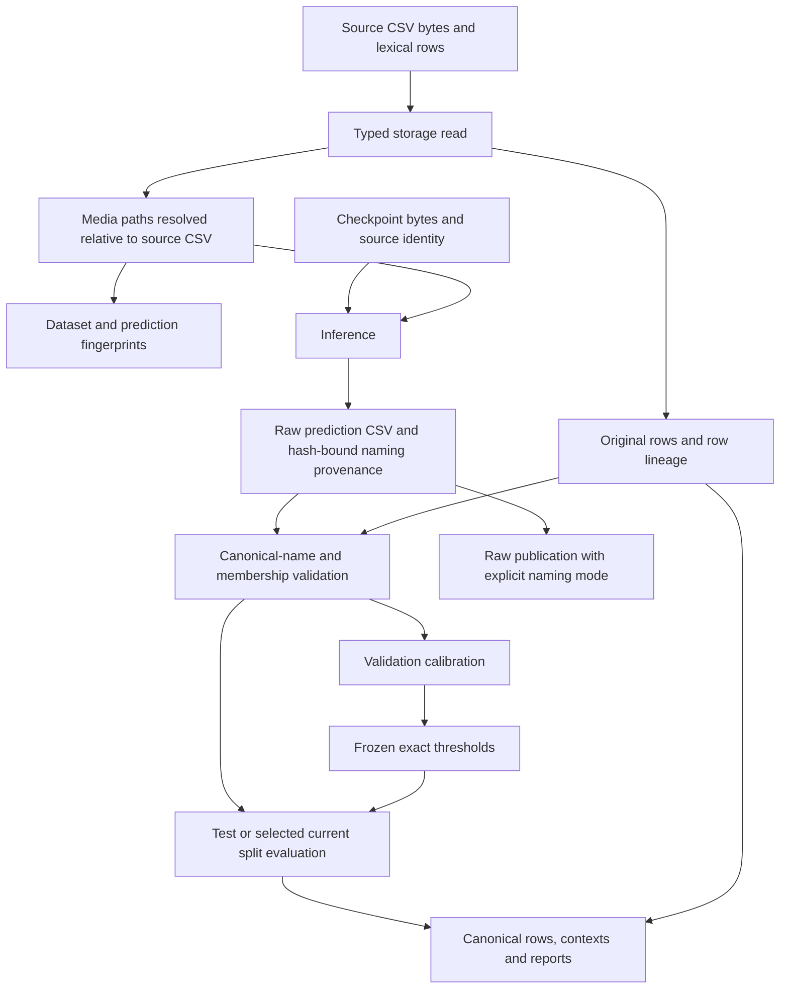

# Detection inputs and evaluation provenance

Storage owns detection-CSV interpretation and filesystem resolution. Core owns pure
identity validation; workflows consume typed storage ports. Generic CSV readers remain
separate from detection readers.

## Ground-truth sources

Every existing `ground_truth` consumer accepts a local CSV path or one of these
ClearML dataset selectors:

```yaml
ground_truth: {dataset_id: DATASET_ID}
# Alternatively, select a dataset by project and name:
# ground_truth: {project_name: annotations, name: ground-truth}
# ground_truth: {project_name: annotations, name: ground-truth, version: "1.2.0"}
```

CLI mappings must be quoted as one override, for example
`'ground_truth={project_name:annotations,name:ground-truth,version:"1.2.0"}'`.
`project_name` identifies the dataset project, independently of the experiment's
`clearml.project_name`. Supply exactly an ID or a complete project/name pair.
Version is optional only with the pair; empty, mixed, incomplete and unknown
fields fail validation before lookup.

The ClearML adapter requires a finalized dataset whose current logical inventory
contains only root `dataset.csv`. Additional files or linked entries are rejected
before download. It requests the CSV using the SDK cache and checks its presence.
Failed lookup, incomplete datasets and missing CSV files fail visibly; lookup never
creates a dataset. Without `version`, selection follows ClearML SDK latest-version
behavior: highest semantic version when available, otherwise the most recently updated.

The selected and materialized input is the unchanged CSV; no image conversion,
upload or path remapping is added. The SDK may fetch whole archive chunks and
populate its cache, including media removed from an inherited dataset's current
inventory. Use a fresh CSV-only dataset lineage when transport must also exclude
historically removed media.

Absolute image references remain absolute. Relative references resolve beside
the downloaded CSV, not beside the original author's CSV or the launch directory.
Images must already be accessible through those paths to the executing process.
The same lexical-row, image-identity and cache rules below apply after resolution.

Application policy resolves the input once per executing invocation and passes
the resolved source through nested stages, including stages consuming a derived
training CSV. A local path continues to work and emits one recommendation to use
a ClearML dataset; internal derived paths do not produce another warning.
`cy-export` still permits absent ground truth.

CLI composition supplies the dataset repository. Existing manual or positional
`WorkflowDependencies` construction remains valid: its new final
`ground_truth_repository` capability defaults to `None`. Local paths need no
repository; embedded callers using dataset selectors must inject one.

Help and configuration inspection/export do not download datasets. Queue
submission validates and preserves selectors without retrieving data. Queue
execution and remote replay resolve the original selector anew. Executable
configuration retains the requested selector; separate
source provenance records the resolved dataset ID, version and CSV digest. An
unversioned selector can therefore resolve to a newer version in a later invocation.
Use an ID or explicit project/name/version to pin the source.

The [source contract](../specs/001-clearml-ground-truth/contracts/input.md) and
[source regressions](../tests/test_ground_truth_sources.py) cover normalization,
resolution, warning and replay behavior.

## CSV interpretation and evaluation



| Boundary | Input → output | Invariant and owner | Failure behavior / check |
| --- | --- | --- | --- |
| Ground-truth source | Local path or dataset selector → resolved CSV and provenance | Application owns validation and one local-input warning; the ClearML adapter owns SDK lookup, CSV-only inventory validation, retrieval and digest | Invalid selectors fail before lookup; missing CSV and additional files/links fail before download; queue submission never retrieves |
| Detection CSV | CSV → lexical source rows and execution view | Literal `NA`, `NULL`, `nan`, `None`, numeric-looking and Unicode identities survive; empty background cells remain empty; row order and numeric precision survive reload | Storage rejects invalid required values; literal-label and round-trip regressions |
| Media resolution | CSV location and lexical image path → resolved execution path | Relative paths use the CSV directory, including Hydra cwd changes; original export rows retain lexical names | Missing/invalid media fails at its consuming boundary; conflicting-cwd regressions |
| Dataset cache | CSV digest, resolved image-reference identity, format, preparation version → entry | Different resolved images separate entries; identical absolute references may reuse; old entries remain | Hit avoids image-content hashing, mtime checks, copy and conversion; unchanged-path image edits require explicit invalidation |
| Prediction provenance | Prediction bytes and checkpoint identity → hash-bound naming mode | New sidecars record `prediction_image_name`; source row lineage remains intact | Hash conflicts fail; historical missing mode is accepted only with canonical membership |
| Evaluation | Canonical `image_name=name` predictions and selected current GT → metrics | `stem`/`path` are raw-export modes; unknown image identities cannot silently disappear | Reject incompatible mode or membership before scoring; canonical baseline parity tests |
| Publication | Raw/evaluated rows plus contexts → canonical artifacts | Raw media association uses explicit naming mode and never claims evaluation; evaluated rows preserve source IDs | Required uploads/flush fail the invocation; download/readback proves lexical identity and lineage |

Validation calibrates candidate thresholds; test and comparison consume frozen thresholds.
Historical source recovery follows the [ordered recovery contract](../specs/000-baseline/spec.md#evaluation-comparison-and-historical-model-recovery),
and artifact/context ownership follows the [publication contract](../specs/000-baseline/spec.md#required-publication-and-task-lifecycle).
Scientific algorithms and approved dependency revisions remain unchanged.
