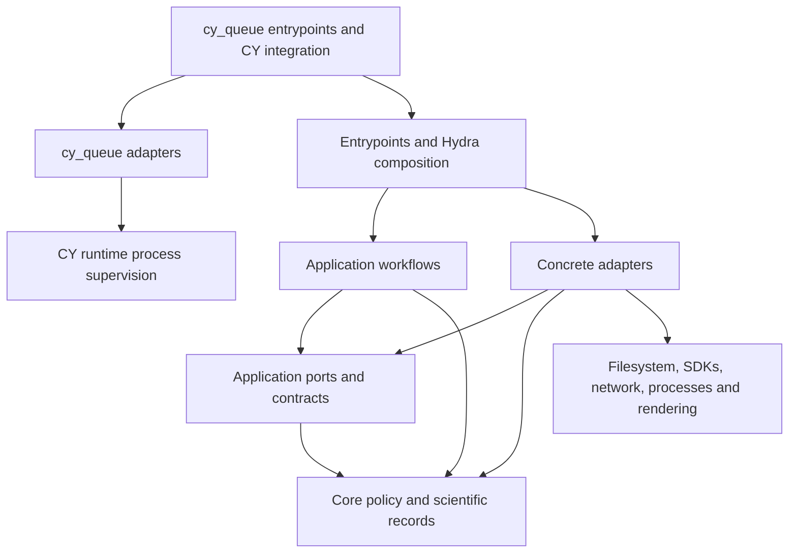

# Module dependencies and effect ownership

The [import contracts](import-boundaries.md) and executable rules in
[.importlinter](../.importlinter) govern the arrows below. A runtime dependency
points inward; composition supplies the concrete implementations of typed ports.

| Boundary | Input → output | Invariant and owner | Failure behavior / check |
| --- | --- | --- | --- |
| Composition | Typed configuration → injected dependencies | Entrypoints construct adapters; no global service lookup | Strict configuration errors; generated configuration and installed-help checks |
| Storage | CSV/path/checkpoint → typed records and resolved media | Storage owns lexical parsing, filesystem resolution and persistence | Invalid data/hash/path fails with context; storage and workflow regression tests |
| Application | Records and ports → workflow results | Effects cross explicit ports; no concrete adapters or SDK construction | Propagate required computation/publication failure; workflow tests |
| Core | Values → policy, validation and evaluation records | No filesystem, environment, process, network or SDK effects | Explicit validation errors; architecture negative fixtures |
| Evaluation / reporting | Scientific inputs → values / rendered reports | Evaluation owns pinned metric integration; reporting owns workbook/plot writes | Geometry policy and metric parity tests; no hidden rendering during computation |
| Assets | Typed source request → verified local path and provenance | CY outer resolver owns HTTP/cache/locks/extraction; backend owns native loading | Explicit missing inputs fail; proxy/offline/integrity and native-loader tests |
| cy_queue / CY runtime | Requests and process identities → claims and cleanup evidence | Separate queue owns admission; CY runtime owns scoped process supervision and lifecycle messages | Unknown coordination fails closed; queue subprocess/generation tests and CY lifecycle tests |

Adapter peer permissions and exact bridges are enumerated in the
[boundary guide](import-boundaries.md#adapter-peers). The drawing does not grant
every adapter access to every effect or peer. Package initializers remain inert.
Static AST checks cover supported source syntax, not arbitrary runtime reflection
or third-party internals; installed and native checks provide separate evidence.

Queue configuration reads and host binding belong to the separate `cy_queue` adapters;
its entrypoints inject
the resolved metadata and coordination locations into storage, workers and guardians.
Core queue records own stable-reference resolution and archive metadata; application
ports own archive/restore and view selection. Storage retains complete ordering history
and atomically writes owner sidecars. Pure presentation helpers format readable references;
terminal, ClearML and workbook adapters own output effects while preserving exact source
provenance. CY has no reverse imports of `cy_queue`, Textual or NVML; the queue
consumes documented CY process, lifecycle and configuration interfaces. Direct
commands and ClearML Agent execution remain independent of queue installation.
See the [cross-package contract](queue.md#cy-integration-interfaces).

The ClearML adapter returns a detached remote replay snapshot before runtime
selection. Entrypoint composition validates restored inputs, selects the runtime
and joins the same task through the invocation lifecycle. Asset resolution occurs
after canonical publication and updates only execution copies; the separate ClearML
`model_assets` Configuration Object records paths, original source URLs and content hashes.

## Cross-contract integration

Pandera validates scientific DataFrames by stage without coercing, dropping or
renumbering source rows. Storage adapters retain lexical CSV interpretation and
compatibility diagnostics. Raw invalid prediction geometry remains source evidence;
evaluation preparation warns and removes it before matching/AP. Native publication
continues to allow finite ordered boxes collapsed by clipping. Evaluation computation
returns project-owned metrics/matches/payloads; rendering alone writes dashboards and
plots, and paired significance calculations use pure core records.
