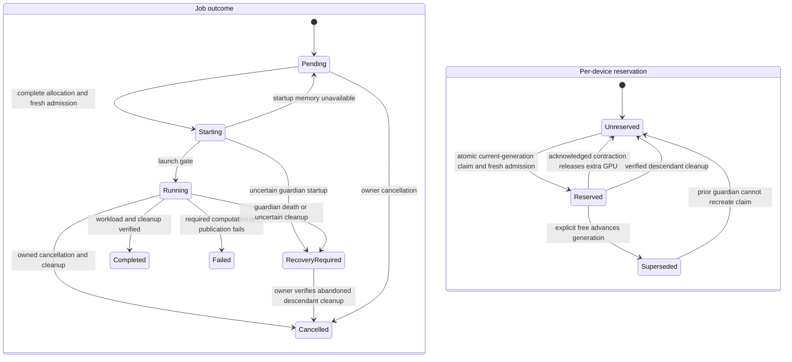

# Queue job and GPU reservation lifecycles

The [queue contract](queue.md) is authoritative. These are separate state machines:
manual GPU freeing changes capacity bookkeeping without completing or cancelling a job.

| Operation | Input → output | Invariant and owner | Failure behavior |
| --- | --- | --- | --- |
| Admission | Whole request, holds, current claims, telemetry → allocation | Queue reserves atomically across roots; used VRAM strictly below 2048 MiB | Missing/high memory returns attempted startup to pending; unknown/damaged coordination blocks admission |
| Handoff | Training return and memory release → durable first-GPU claim and acknowledgement | Guardian shrinks before releasing extras and acknowledging; no notification retains all GPUs | Lost acknowledgement stops inference; released extras are never restored |
| Finalization | Computation/uploads → ClearML task status; process proof → queue outcome | Job owns required publication; guardian owns descendant cleanup | Successful task can precede cleanup; later uncertainty retains recovery evidence |
| Free | Physical device → new reservation generation | Operator transaction supersedes only that device's existing holds/claims | No signals or job-outcome change; older guardian cannot alter new claims |
| Recovery | Owner request and verified descendant cleanup → cancelled queue job | Only owner recovers; cleanup does not certify the original workload outcome or alter completed ClearML status | Ambiguous/inaccessible evidence remains unresolved; stale unlocked metadata alone is no capacity veto |

An explicit hold is independent of job state. Free clears existing holds; a subsequent
disable or allocation applies normally. Every new job still needs fresh memory admission.
See [operator controls](queue.md#physical-gpu-operator-controls) and the
[verification/status map](implementation-status.md) for executed versus external checks.
